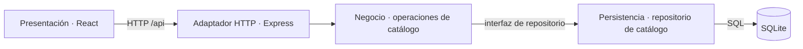
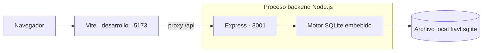

# Arquitectura preliminar · vistas 4+1

FIAVL Explora usa arquitectura en capas (Layered Architecture), implementada mediante un modelo cliente-servidor con tres capas lógicas de presentación, negocio y persistencia.

## Vista lógica

React presenta los eventos en hora de Loja. En el servidor, Express traduce peticiones y resultados a HTTP. El servicio decide si una identidad es inválida o una ficha está ausente y comprueba la lectura antes de declarar salud. El repositorio ejecuta SQL y convierte filas a los contratos públicos con Zod. SQLite conserva la edición y aplica las claves foráneas.

## Vista de desarrollo

Web y API comparten los esquemas de `packages/contracts`. En `apps/api/src`, `server.ts` abre SQLite y `composition.ts` conecta `repositories/catalog.ts`, el servicio `catalog.ts` y la aplicación HTTP `app.ts`. El servicio declara la interfaz que implementa el repositorio. Este particionamiento técnico reúne las responsabilidades de transporte, negocio y datos de todo el catálogo. Un monolito modular agruparía esas responsabilidades dentro de módulos por dominio.

Las nueve entradas de UI exportan ruta, etiqueta, disponibilidad y componente. Reservas y opiniones tienen un router, una entrada de composición y una prueba por propietario. Spec 1 dejó ambos namespaces en 501; Reservas (Spec 6) ya implementa su contrato (docs/contracts.md) y Opiniones se rige por el suyo. [Mapa de propiedad](../AGENTS.md).

## Vista de procesos

El navegador solicita `/api/events` de forma asíncrona. El handler llama al servicio y el repositorio lee mediante la conexión abierta al arrancar. Las escrituras de migración y seed usan BEGIN IMMEDIATE con rollback y espera limitada por bloqueo. La portada anuncia carga, vacío o fallo y permite un nuevo intento.

## Vista física

El entorno local usa loopback. La ruta de base puede cambiarse con FIAVL_DB. El build crea apps/web/dist y apps/api/dist. El JavaScript compilado del servidor requiere las migraciones y el workspace contracts junto a la aplicación.

## Escenario +1

Abrir la portada inicia la lectura de eventos. El repositorio reconstruye artistIds según orden de crédito, Express devuelve JSON y el navegador muestra los primeros tres eventos. Abrir /reservas presenta su disponibilidad; reservar y cancelar usan el namespace de escritura, que valida el aforo y persiste en SQLite. Reiniciar conserva las mismas fichas.
