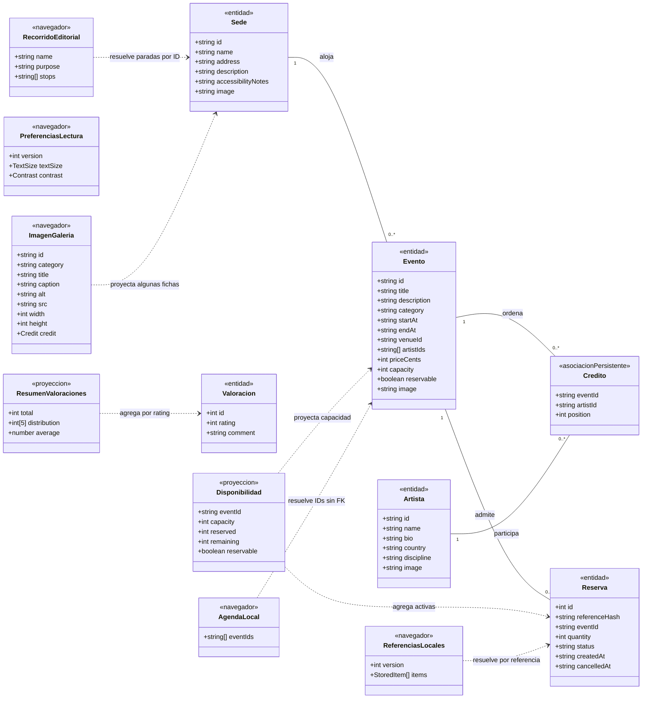

# Vista lógica

## LOG-01 · Dominio y estructuras relevantes

El estilo por capas distribuye responsabilidades de presentación, negocio y acceso a datos. El dibujo usa clases conceptuales para expresar atributos y relaciones. En TypeScript el dominio se materializa como tipos, interfaces, valores y fábricas de operaciones. [Inventario técnico](analysis/01-inventario-arquitectonico.md).

<!-- diagram: LOG-01 -->

- Cada evento exige una sede. Una sede puede alojar cero o más eventos. Cada crédito exige un evento y un artista. Un evento o artista puede tener cero o más créditos. La tabla asociativa impone unicidad de la pareja y de la posición por evento. El DTO de evento proyecta esa relación como `artistIds` ordenados. [Migración de base](../../apps/api/migrations/001_base.sql), [repositorio de catálogo](../../apps/api/src/repositories/catalog.ts).
- Los DTO de catálogo exigen IDs slug, textos obligatorios, imágenes SVG locales, importes en centavos USD y fechas con segundos y `-05:00`. El fin debe ser posterior al inicio. Algunos controles son más específicos en Zod que en las restricciones físicas. [Contratos](../../packages/contracts/src/index.ts), [migración de base](../../apps/api/migrations/001_base.sql).
- Cada reserva refiere a un evento. La vista HTTP expone la referencia en claro, mientras SQLite guarda su hash único e ID privado. `cancelledAt` admite `null` en estado activo. La disponibilidad agrega solo reservas activas. [Migración 006](../../apps/api/migrations/006_reservations.sql), [servicio](../../apps/api/src/services/reservations.ts), [DTO de navegador](../../apps/web/src/features/reservas/logic.ts).
- La valoración tiene ID interno, puntuación y comentario anulable. El resumen es una proyección de todas las filas y tiene promedio anulable cuando el total es cero. [Migración 010](../../apps/api/migrations/010_feedback.sql), [servicio](../../apps/api/src/services/feedback.ts).
- Las flechas discontinuas de navegador indican resolución o proyección, sin integridad referencial. La agenda guarda directamente el arreglo de IDs. Las referencias guardan `reference`, `eventId` y `quantity` dentro de `items`. La guía guarda opciones versionadas. Recorridos y galería se reconstruyen con datos del módulo y estado de React. [Almacenamiento](../../apps/web/src/lib/storage.ts), [recorridos](../../apps/web/src/features/rutas/itinerarios.ts), [galería](../../apps/web/src/features/galeria/logic.ts).
