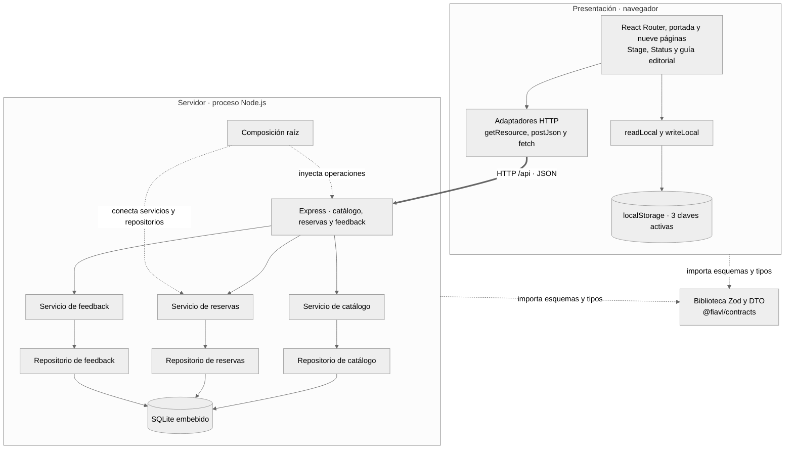
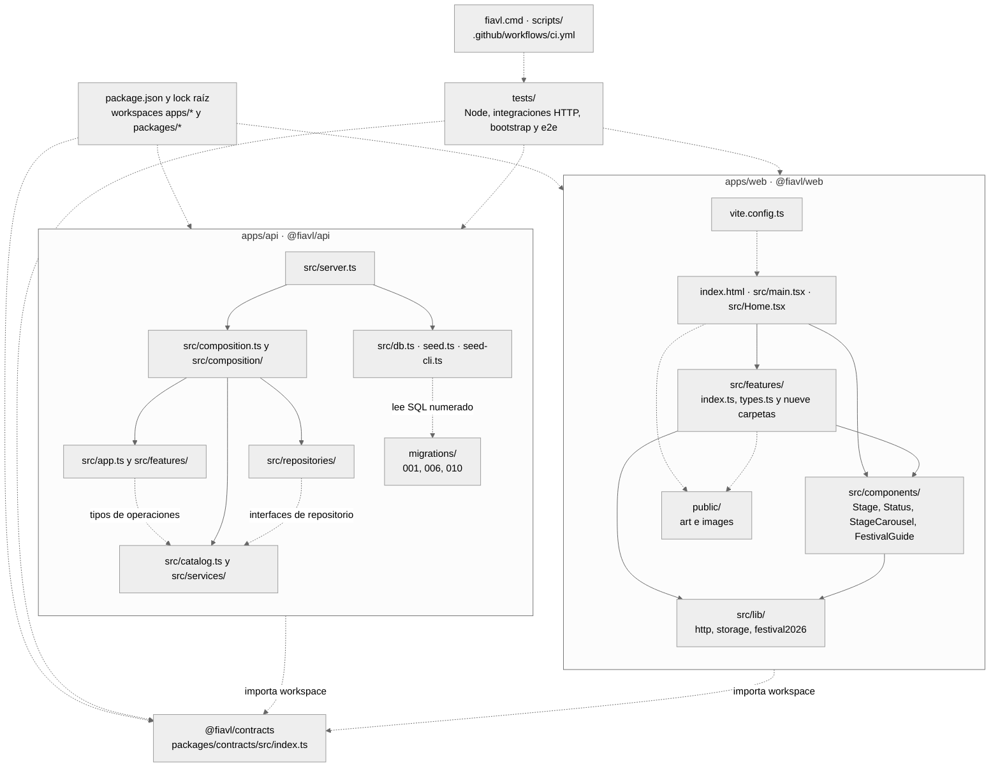

# Vista de desarrollo

## DES-01 · Componentes y responsabilidades

La línea gruesa representa el intercambio HTTP en ejecución. Las líneas de trazo fino continuo representan llamadas y uso interno. Las líneas discontinuas muestran composición o dependencias estáticas. El proxy y los puertos se detallan en la vista física.

<!-- diagram: DES-01 -->

La composición raíz entrega operaciones a Express e inyecta las implementaciones de repositorio en los servicios de catálogo, reservas y feedback. La flecha de composición hacia reservas ilustra este patrón. React valida la información recibida mediante esquemas. Los servicios validan las entradas pertinentes y el repositorio de catálogo valida sus proyecciones. Los contratos se importan como biblioteca. [Composición](../../apps/api/src/composition.ts), [router raíz](../../apps/api/src/app.ts), [cliente HTTP](../../apps/web/src/lib/http.ts), [contratos](../../packages/contracts/src/index.ts).

## DES-02 · Paquetes y dependencias estáticas

Los recintos representan paquetes npm y las rutas muestran la organización del repositorio. Las flechas continuas representan importaciones o referencias internas principales. Las discontinuas añaden dependencias de tipos, lectura de archivos o uso por herramientas. La comunicación HTTP se muestra en DES-01.

<!-- diagram: DES-02 -->

`apps/web` y `apps/api` dependen del workspace `@fiavl/contracts`. Los repositorios importan desde negocio las interfaces que implementan. En ejecución los servicios llaman al repositorio inyectado. Los scripts y las pruebas se ubican en la raíz y ejercitan los paquetes. [Manifest raíz](../../package.json), [Web](../../apps/web/package.json), [API](../../apps/api/package.json), [contratos](../../packages/contracts/package.json), [configuración de Playwright](../../playwright.config.ts).
