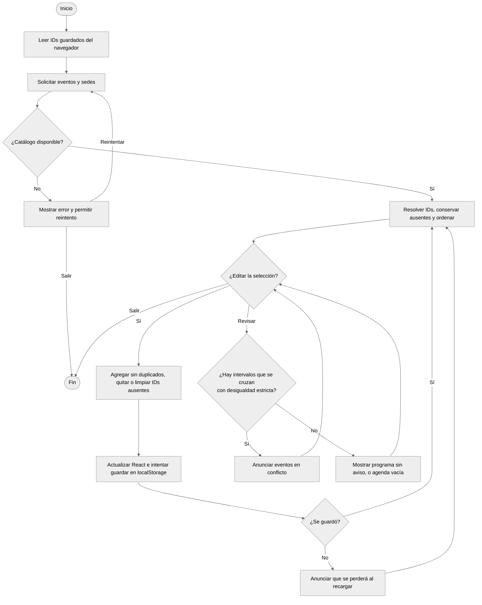

# ACTV-01 · Planificar la agenda y detectar conflictos

**Casos** CU-09, CU-10. Expone el ciclo de edición, guardado tolerante a fallos y revisión de conflictos. La lectura fallida se puede reintentar con la selección local intacta.

<!-- diagram: ACTV-01 -->

Las salidas de los rombos llevan condiciones y los nodos redondeados delimitan el inicio y el fin de la actividad. [apps/web/src/features/mi-agenda/index.tsx](../../../../apps/web/src/features/mi-agenda/index.tsx), [apps/web/src/features/mi-agenda/logic.ts](../../../../apps/web/src/features/mi-agenda/logic.ts), [tests/spec-05.test.ts](../../../../tests/spec-05.test.ts).
