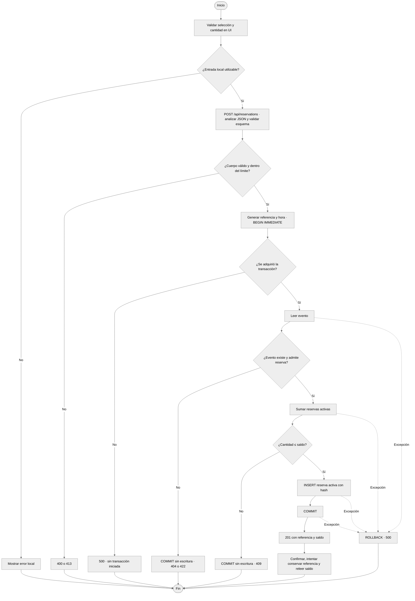

# ACTV-02 · Validar y confirmar una reserva

**Casos** CU-12. Hace visibles las ramas de validación, evento, aforo y excepción. La decisión de aforo ocurre dentro de la transacción.

<!-- diagram: ACTV-02 -->

Las salidas de los rombos llevan condiciones y los nodos redondeados delimitan el inicio y el fin de la actividad. [apps/api/src/services/reservations.ts](../../../../apps/api/src/services/reservations.ts), [apps/api/src/repositories/reservations.ts](../../../../apps/api/src/repositories/reservations.ts), [tests/reservations.test.ts](../../../../tests/reservations.test.ts).
