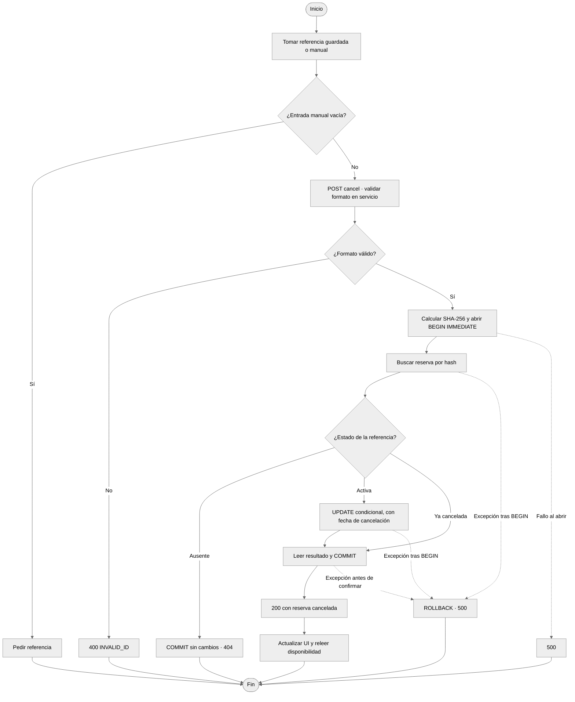

# ACTV-03 · Cancelar una reserva de forma idempotente

**Casos** CU-14. Distingue el cambio de activa a cancelada de una solicitud repetida. El saldo vuelve a calcularse a partir de las activas.

<!-- diagram: ACTV-03 -->

Las salidas de los rombos llevan condiciones y los nodos redondeados delimitan el inicio y el fin de la actividad. [apps/api/src/services/reservations.ts](../../../../apps/api/src/services/reservations.ts), [apps/api/src/repositories/reservations.ts](../../../../apps/api/src/repositories/reservations.ts), [tests/reservations.test.ts](../../../../tests/reservations.test.ts).
