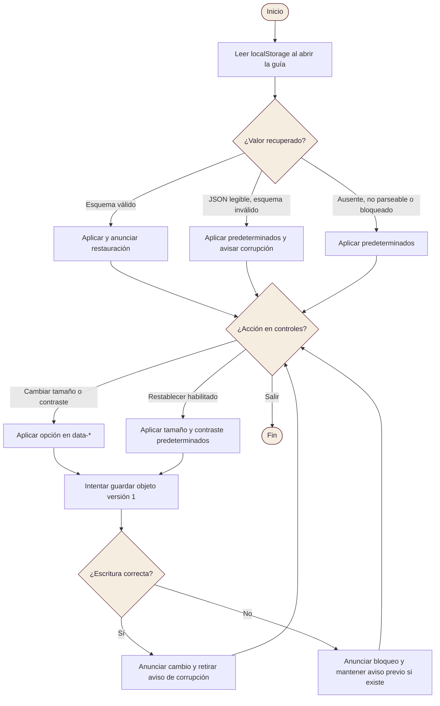

# ACTV-04 · Restaurar y ajustar preferencias de lectura

**Casos** CU-19. Expone la recuperación de datos fuera de esquema, el restablecimiento y la posibilidad de aplicar un ajuste que no se pudo guardar.

<!-- diagram: ACTV-04 -->

Las salidas de los rombos llevan condiciones y los nodos redondeados delimitan el inicio y el fin de la actividad. [apps/web/src/features/accesibilidad/index.tsx](../../../../apps/web/src/features/accesibilidad/index.tsx), [apps/web/src/lib/storage.ts](../../../../apps/web/src/lib/storage.ts), [tests/e2e/spec-09.spec.ts](../../../../tests/e2e/spec-09.spec.ts).
