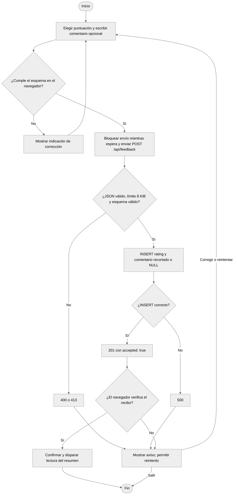

# ACTV-05 · Validar y confirmar una valoración

**Casos** CU-21. Distingue validación cliente/servidor, persistencia y confirmación del recibo. El reintento del formulario puede ocurrir tras una respuesta no confirmada.

<!-- diagram: ACTV-05 -->

Las salidas de los rombos llevan condiciones y los nodos redondeados delimitan el inicio y el fin de la actividad. [apps/web/src/features/opiniones/index.tsx](../../../../apps/web/src/features/opiniones/index.tsx), [apps/api/src/features/feedback.ts](../../../../apps/api/src/features/feedback.ts), [apps/api/src/services/feedback.ts](../../../../apps/api/src/services/feedback.ts), [tests/feedback.test.ts](../../../../tests/feedback.test.ts).
