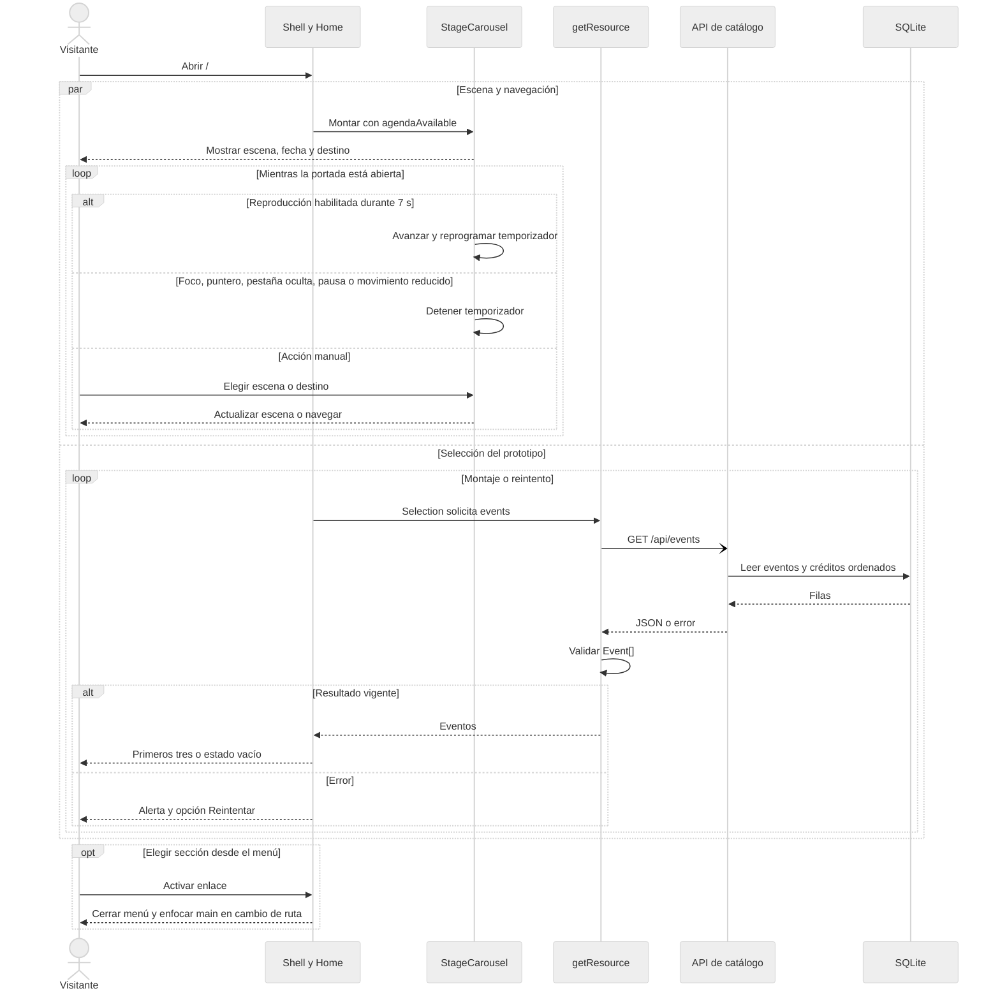

# CU-01 · Descubrir la edición demo

**Actor** Visitante (ACT-01). **Spec** 1. Reconocer la edición y llegar a una sección o a la selección demo.

<!-- diagram: CU-01 -->

Lectura SQLite. Escena y menú en memoria.

[Catálogo detallado](../../analysis/02-actores-y-casos-de-uso.md) · [Vista de procesos](../README.md).
