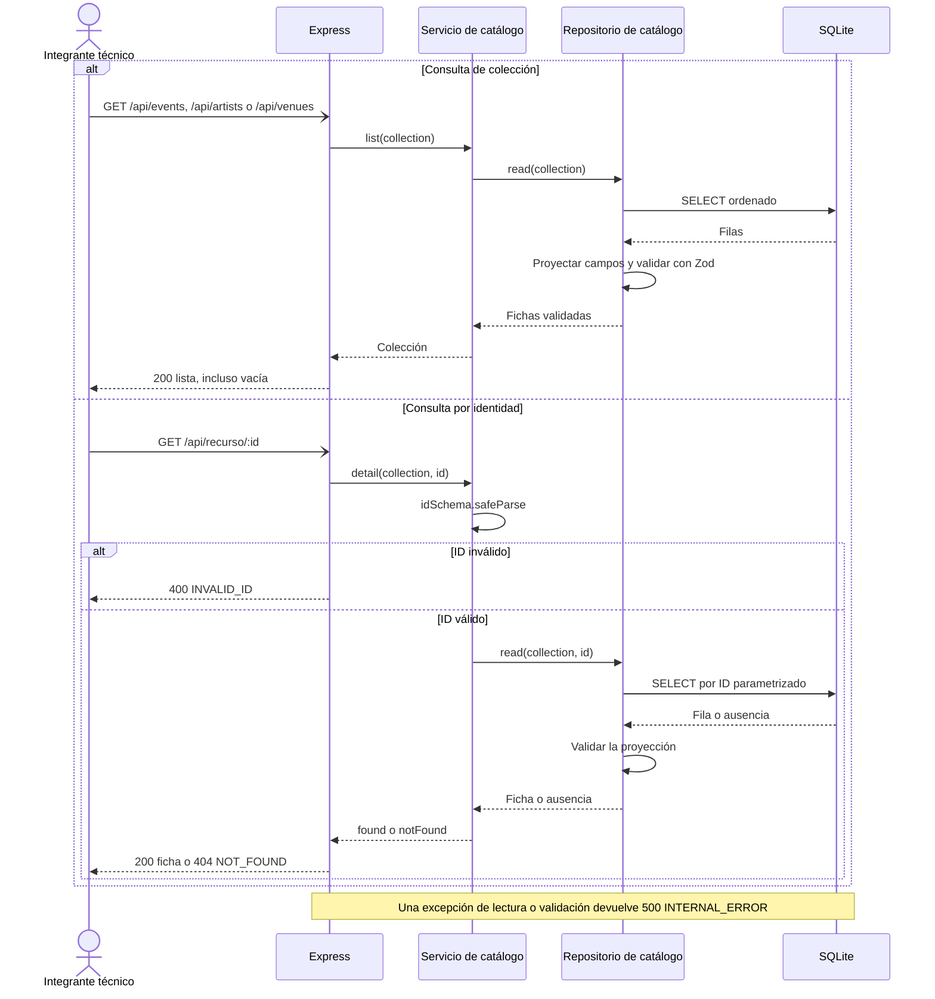

# CU-02 · Consultar el catálogo mediante la API pública

**Actor** Integrante técnico (ACT-02). **Spec** 1. Obtener una colección demo o recuperar una ficha por identidad.

<!-- diagram: CU-02 -->

Lectura de events, venues, artists y event_artists.

[Catálogo detallado](../../analysis/02-actores-y-casos-de-uso.md) · [Vista de procesos](../README.md).
