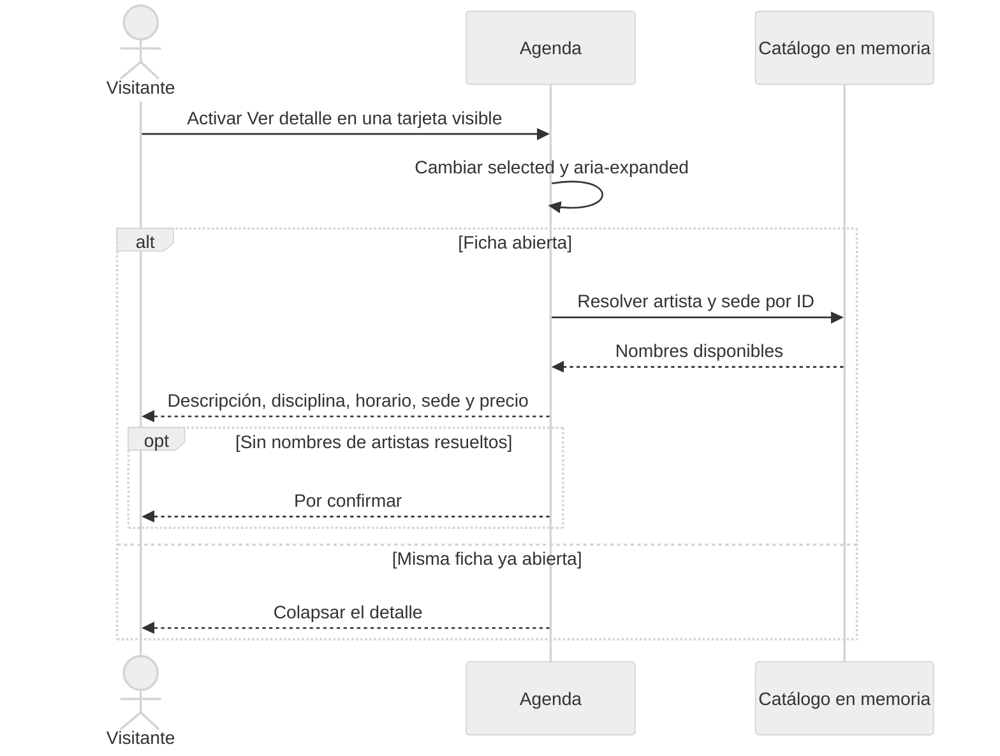

# CU-04 · Consultar el detalle de un evento

**Actor** Visitante (ACT-01). **Spec** 2. Conocer descripción, horario completo, sede, artistas y precio de un evento.

<!-- diagram: CU-04 -->

El objetivo se completa con datos o estado del navegador. Memoria del navegador.

[Catálogo detallado](../../analysis/02-actores-y-casos-de-uso.md) · [Vista de procesos](../README.md).
