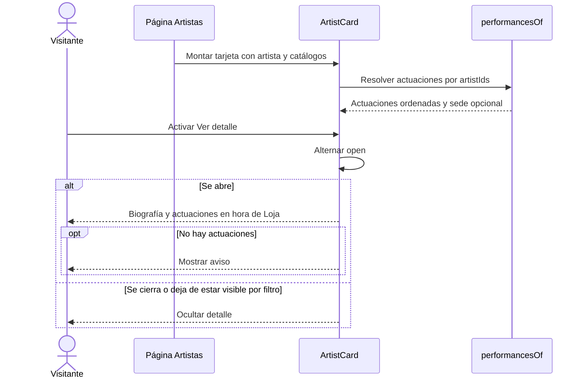

# CU-06 · Consultar la trayectoria y actuaciones de un artista

**Actor** Visitante (ACT-01). **Spec** 3. Leer la biografía y saber en qué eventos participa un artista.

<!-- diagram: CU-06 -->

El objetivo se completa con datos o estado del navegador. Memoria del navegador.

[Catálogo detallado](../../analysis/02-actores-y-casos-de-uso.md) · [Vista de procesos](../README.md).
