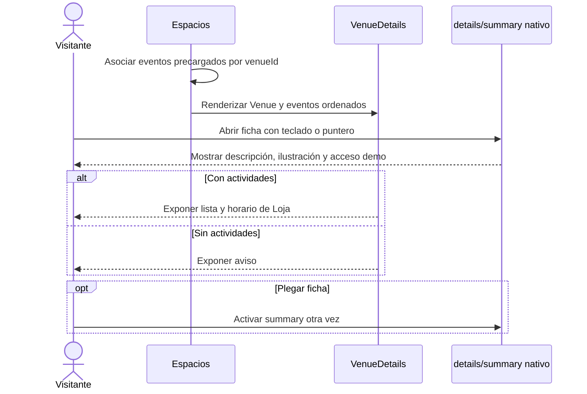

# CU-08 · Consultar una sede demo y sus actividades

**Actor** Visitante (ACT-01). **Spec** 4. Conocer dónde está una sede, sus notas demo de acceso y sus actividades.

<!-- diagram: CU-08 -->

El objetivo se completa con datos o estado del navegador. Memoria del navegador.

[Catálogo detallado](../../analysis/02-actores-y-casos-de-uso.md) · [Vista de procesos](../README.md).
