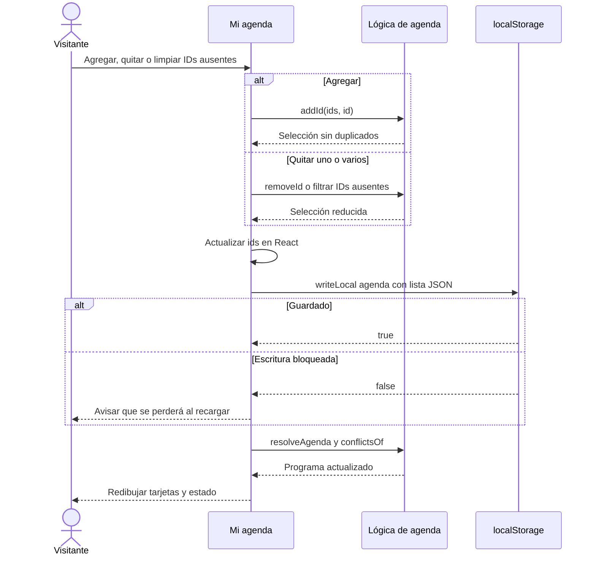

# CU-09 · Armar mi agenda personal

**Actor** Visitante (ACT-01). **Spec** 5. Guardar o quitar eventos de mi selección personal.

<!-- diagram: CU-09 -->

El objetivo se completa con datos o estado del navegador. `fiavl:agenda:v1`, lista de IDs por origen de navegador.

[Catálogo detallado](../../analysis/02-actores-y-casos-de-uso.md) · [Vista de procesos](../README.md).
