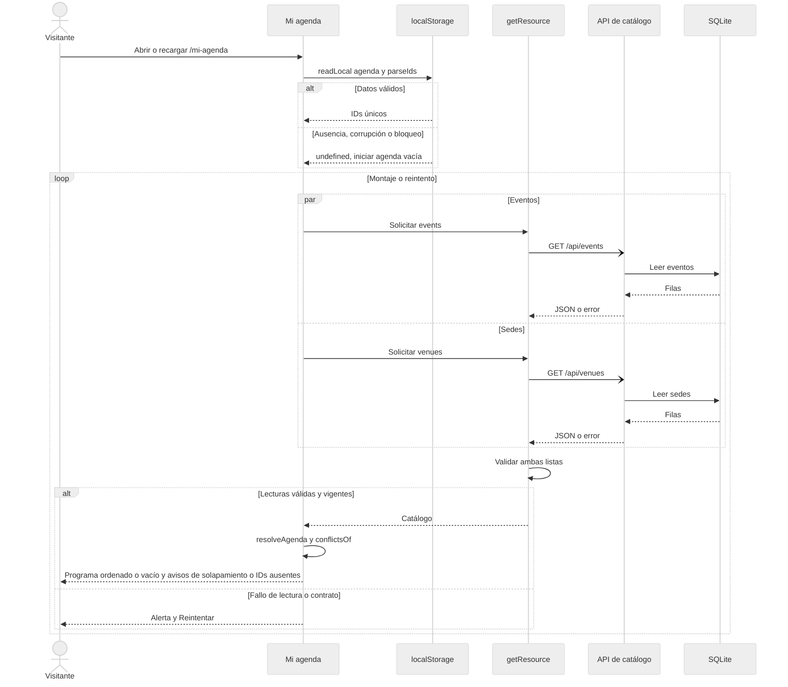

# CU-10 · Revisar mi programa y sus solapamientos

**Actor** Visitante (ACT-01). **Spec** 5. Recuperar el programa y detectar conflictos de horarios.

<!-- diagram: CU-10 -->

Lectura de SQLite para el catálogo y de `fiavl:agenda:v1` para la selección.

[Catálogo detallado](../../analysis/02-actores-y-casos-de-uso.md) · [Vista de procesos](../README.md).
