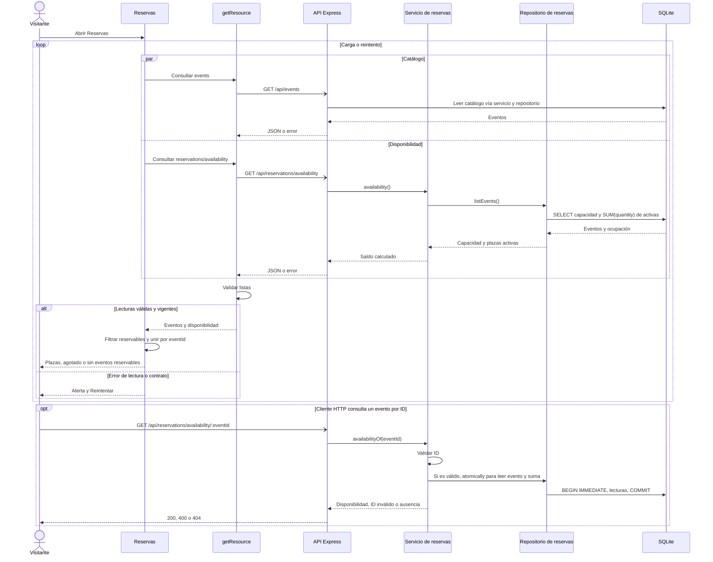

# CU-11 · Consultar plazas disponibles

**Actor** Visitante (ACT-01). **Spec** 6. Saber qué eventos admiten reserva y cuántas plazas les quedan.

<!-- diagram: CU-11 -->

Lectura de events y reservations.

[Catálogo detallado](../../analysis/02-actores-y-casos-de-uso.md) · [Vista de procesos](../README.md).
