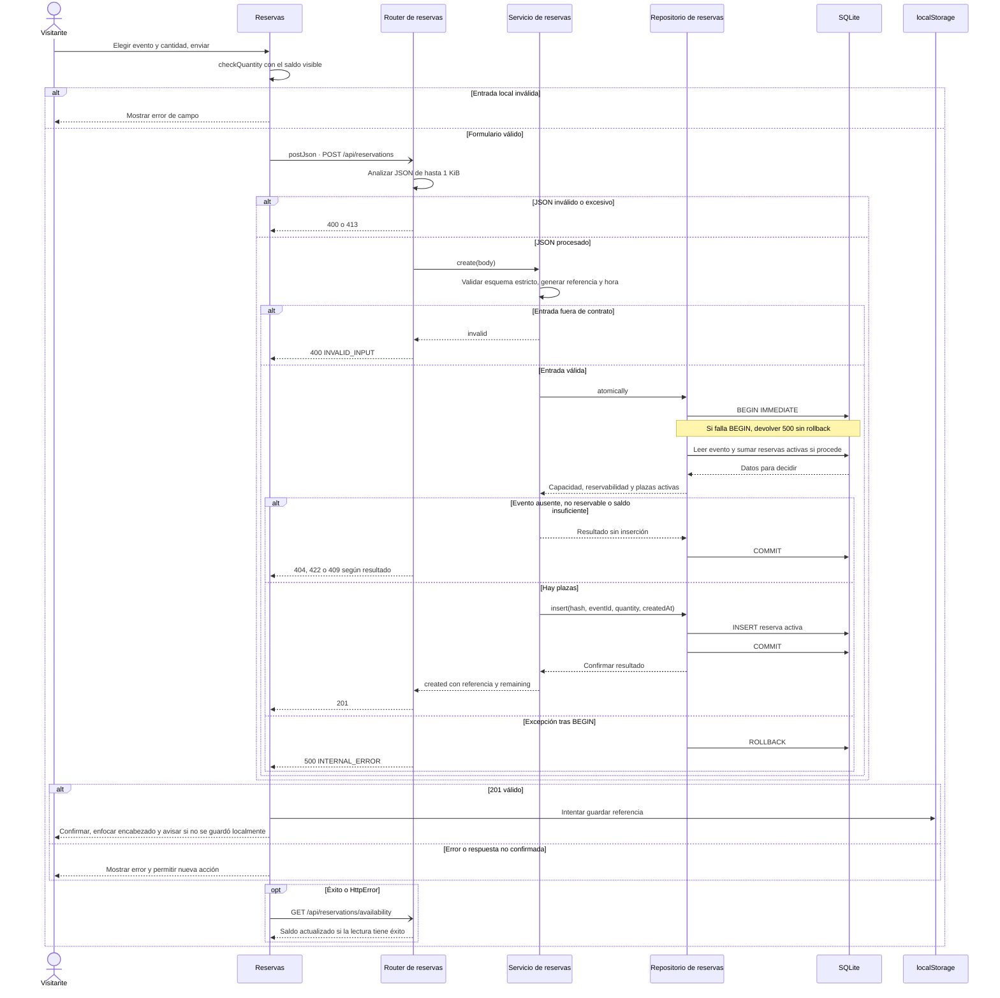

# CU-12 · Reservar plazas demostrativas

**Actor** Visitante (ACT-01). **Spec** 6. Obtener una reserva activa y una referencia para recuperarla o cancelarla.

<!-- diagram: CU-12 -->

SQLite y copia local `{reference,eventId,quantity}` si está disponible.

[Catálogo detallado](../../analysis/02-actores-y-casos-de-uso.md) · [Vista de procesos](../README.md).
