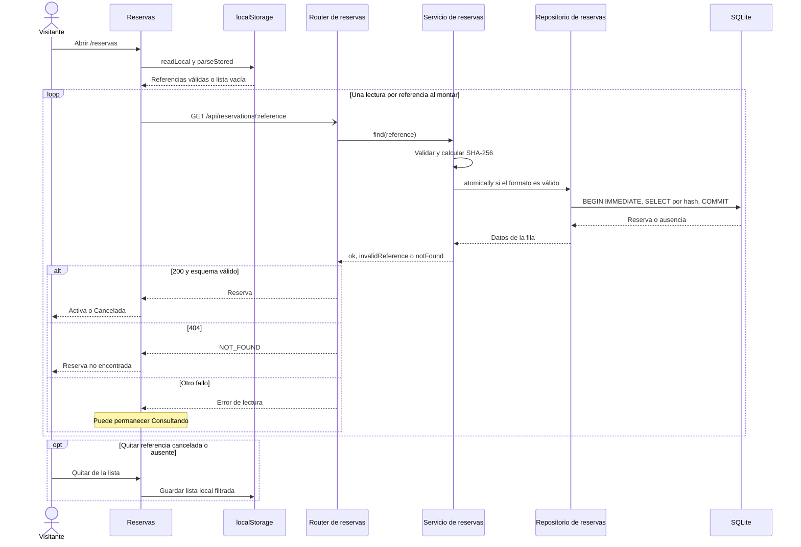

# CU-13 · Consultar mis reservas por referencia

**Actor** Visitante (ACT-01). **Spec** 6. Recuperar el estado de las referencias recordadas y gestionar esa lista local.

<!-- diagram: CU-13 -->

Lectura SQLite y lectura/escritura condicional de `fiavl:reservations:v1`.

[Catálogo detallado](../../analysis/02-actores-y-casos-de-uso.md) · [Vista de procesos](../README.md).
