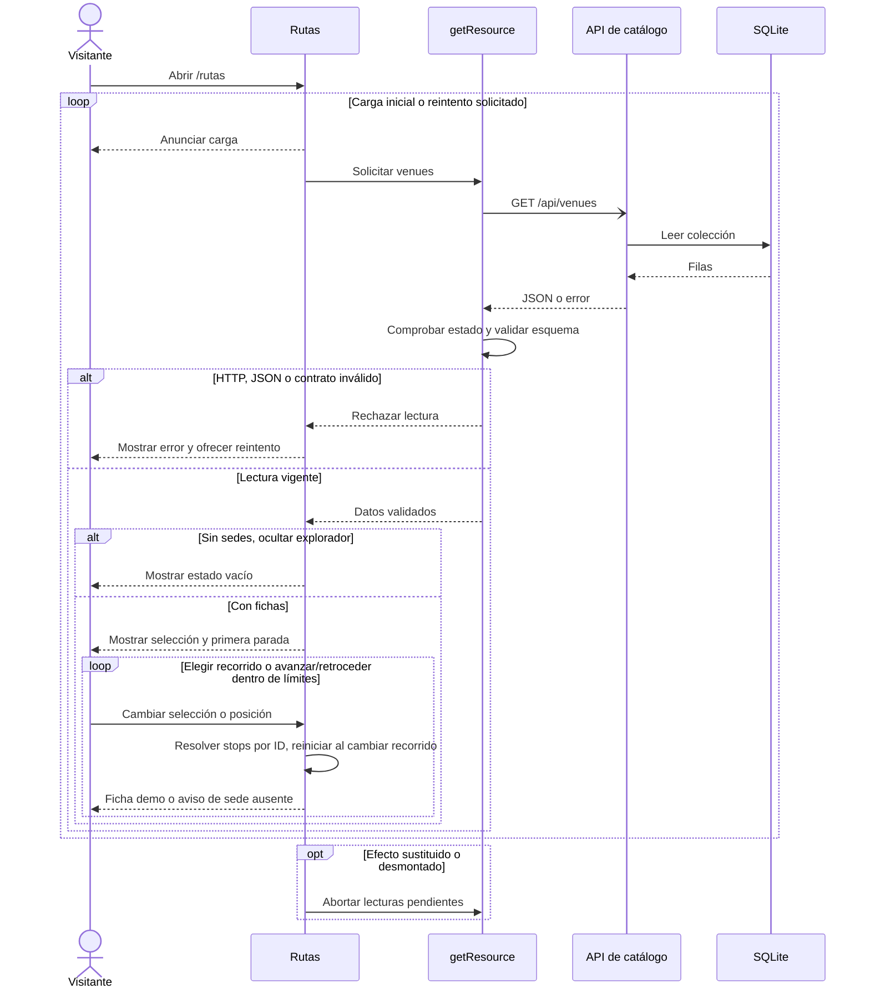

# CU-15 · Explorar un recorrido cultural

**Actor** Visitante (ACT-01). **Spec** 7. Recorrer una secuencia temática de sedes y conocer cada parada.

<!-- diagram: CU-15 -->

Lectura SQLite; itinerarios y estado en navegador.

[Catálogo detallado](../../analysis/02-actores-y-casos-de-uso.md) · [Vista de procesos](../README.md).
