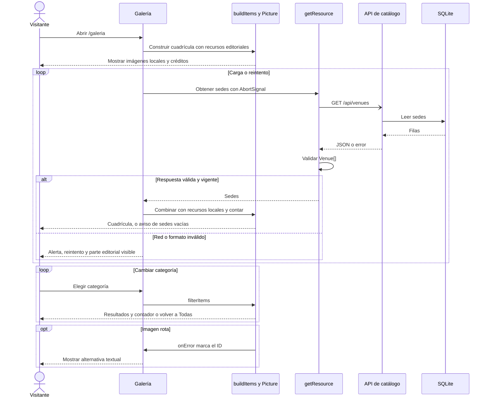

# CU-16 · Explorar la galería por categorías

**Actor** Visitante (ACT-01). **Spec** 8. Encontrar imágenes y reconocer su procedencia.

<!-- diagram: CU-16 -->

Lectura SQLite para sedes; inventario y filtros en memoria.

[Catálogo detallado](../../analysis/02-actores-y-casos-de-uso.md) · [Vista de procesos](../README.md).
