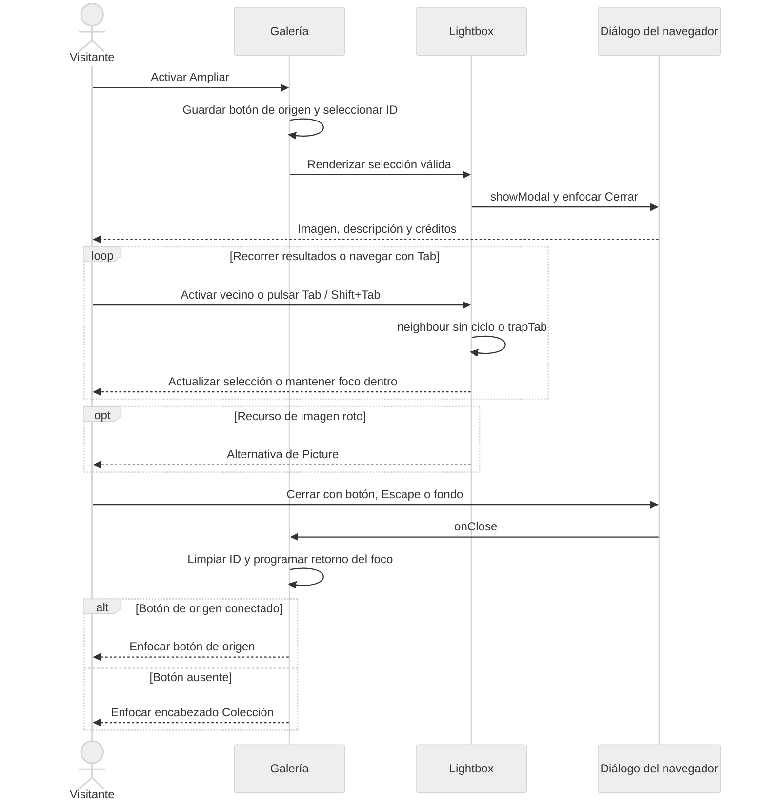

# CU-17 · Ampliar y recorrer imágenes de la galería

**Actor** Visitante (ACT-01). **Spec** 8. Examinar una imagen ampliada y sus créditos, y recorrer resultados vecinos.

<!-- diagram: CU-17 -->

El objetivo se completa con datos o estado del navegador. Estado temporal del navegador.

[Catálogo detallado](../../analysis/02-actores-y-casos-de-uso.md) · [Vista de procesos](../README.md).
