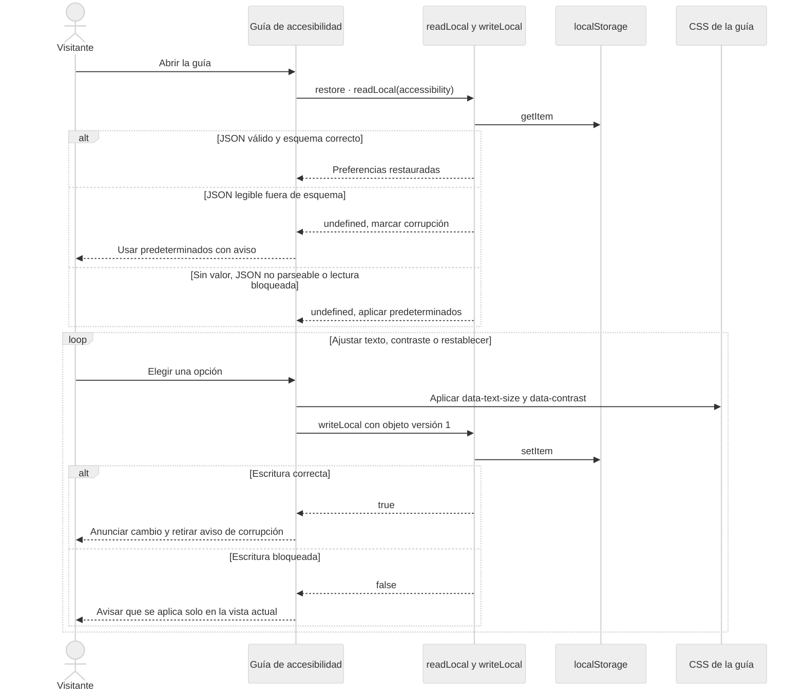

# CU-19 · Personalizar la lectura de la guía

**Actor** Visitante (ACT-01). **Spec** 9. Ajustar y conservar tamaño y contraste o recuperar los valores predeterminados.

<!-- diagram: CU-19 -->

El objetivo se completa con datos o estado del navegador. `fiavl:accessibility:v1`, `{version:1,textSize,contrast}`.

[Catálogo detallado](../../analysis/02-actores-y-casos-de-uso.md) · [Vista de procesos](../README.md).
