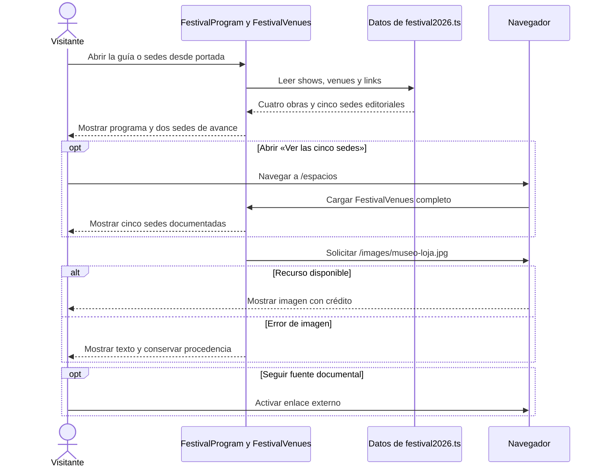

# CU-20 · Consultar la guía editorial del FIAVL 2026

**Actor** Visitante (ACT-01). **Spec** 10. Identificar obras, artistas, horarios y sedes documentadas y acceder a la fuente.

<!-- diagram: CU-20 -->

El objetivo se completa con datos o estado del navegador. Datos fuente en el código de presentación.

[Catálogo detallado](../../analysis/02-actores-y-casos-de-uso.md) · [Vista de procesos](../README.md).
