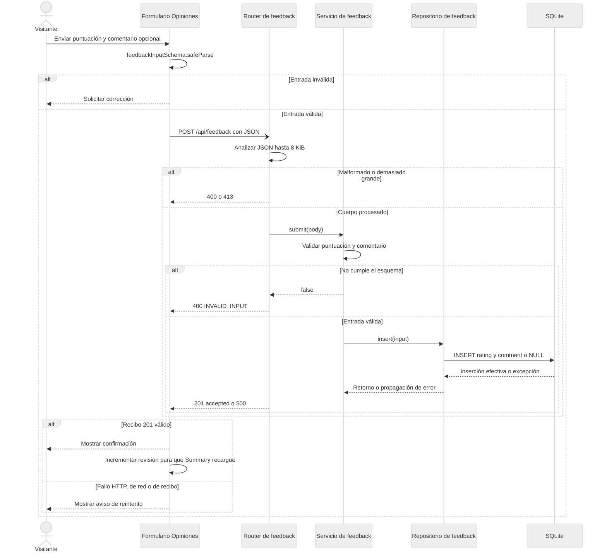

# CU-21 · Enviar una valoración sobre la experiencia

**Actor** Visitante (ACT-01). **Spec** 10. Compartir una puntuación y un comentario opcional y recibir confirmación.

<!-- diagram: CU-21 -->

SQLite feedback. Estado del formulario en memoria.

[Catálogo detallado](../../analysis/02-actores-y-casos-de-uso.md) · [Vista de procesos](../README.md).
