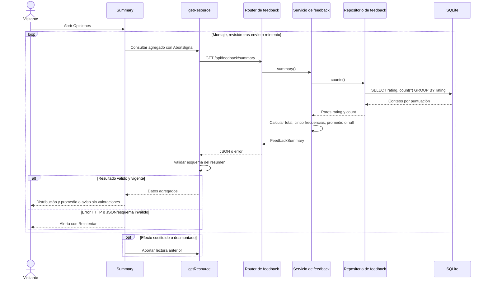

# CU-22 · Consultar el resumen de valoraciones

**Actor** Visitante (ACT-01). **Spec** 10. Conocer el total, la distribución y el promedio agregado de respuestas.

<!-- diagram: CU-22 -->

Lectura agregada de SQLite, sin almacenar resultados en localStorage.

[Catálogo detallado](../../analysis/02-actores-y-casos-de-uso.md) · [Vista de procesos](../README.md).
