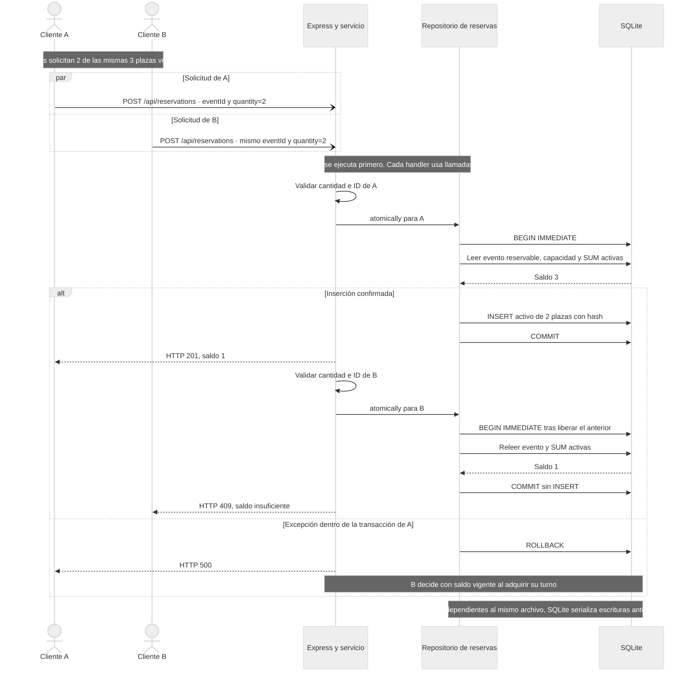

# TEC-01 · Contención por el mismo aforo

Escenario técnico complementario de [CU-12](CU-12-reservar-plazas.md). Las referencias «Cliente A» y «Cliente B» son dos instancias del mismo rol Visitante.

<!-- diagram: TEC-01 -->

En el proceso habitual, los handlers y `DatabaseSync` ejecutan sus llamadas de forma síncrona. Dos solicitudes pueden llegar de forma concurrente, aunque sus operaciones de SQLite no se intercalan dentro de un mismo hilo. Con conexiones independientes al mismo archivo, `BEGIN IMMEDIATE` adquiere el bloqueo de escritura antes de leer el saldo. El `busy_timeout` está configurado en 5000 ms. Si falla el propio `BEGIN`, la excepción se propaga sin ejecutar rollback. Si falla una operación tras iniciarlo, el repositorio revierte y propaga la excepción. El middleware común responde 500 ante un fallo inesperado. Una consulta previa de disponibilidad es una instantánea. [Configuración de SQLite](../../../../apps/api/src/db.ts), [repositorio](../../../../apps/api/src/repositories/reservations.ts), [pruebas de una y dos conexiones](../../../../tests/reservations.test.ts).

La prueba versionada usa dos solicitudes en una conexión y seis solicitudes sobre dos plazas repartidas entre dos conexiones. Sus servidores de prueba conviven en un proceso Node.js. El diagrama expone la llegada concurrente y la regla de consistencia que se usa también entre conexiones. [Prueba de concurrencia](../../../../tests/reservations.test.ts).
