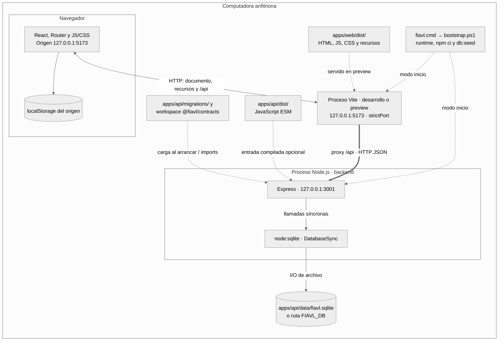

# Vista física

## FIS-01 · Despliegue local documentado

El diagrama muestra la topología local reproducible. El navegador y los dos procesos de servidor comparten la computadora anfitriona. El motor de datos se ejecuta dentro del proceso Node.js. La flecha de Express a SQLite resume el acceso síncrono que pasa por servicios y repositorios, detallado en la [vista de desarrollo](02-vista-desarrollo.md).

<!-- diagram: FIS-01 -->

| Entorno | Arranque y artefactos |
|---|---|
| Desarrollo Windows | `fiavl.cmd` ejecuta PowerShell, resuelve Node **24.22.3** y npm **11.17.0**, prepara dependencias y ejecuta `db:seed -- --if-empty`. El modo inicio lanza `npm run dev`, que arranca Vite y la API TypeScript mediante `node --watch`. |
| Desarrollo manual | El flujo del README fija el runtime, usa `npm ci`, prepara la semilla y lanza `npm run dev`. El arranque ordinario de `server.ts` migra. La semilla proviene del paso previo. |
| Compilación y preview | TypeScript emite `apps/api/dist/`. Vite genera `apps/web/dist/`. La comprobación manual prevista usa `node apps/api/dist/server.js` y Vite preview con las mismas direcciones y proxy. El backend conserva dependencia del workspace de contratos, sus paquetes y las migraciones. |
| Base y preferencias | SQLite usa `apps/api/data/fiavl.sqlite` por defecto. `FIAVL_DB` permite cambiar su ubicación, con preferencia del entorno sobre `.env`. Las claves de `localStorage` corresponden al origen de la página, incluido el puerto. |
| Despliegue futuro | Para otro servidor de estáticos habría que mantener el enrutamiento de la SPA y la redirección de `/api` hacia Express. El modelo representa el entorno local versionado. |

Los puertos efectivos se encuentran en [Vite](../../apps/web/vite.config.ts) y [servidor Node.js](../../apps/api/src/server.ts). La resolución de datos se implementa en [db.ts](../../apps/api/src/db.ts) y [seed-cli.ts](../../apps/api/src/seed-cli.ts). Los requisitos y modos de Windows se implementan en [fiavl.cmd](../../fiavl.cmd) y [bootstrap.ps1](../../scripts/bootstrap.ps1). La [configuración de compilación](../../apps/api/tsconfig.build.json) determina el artefacto de API.
