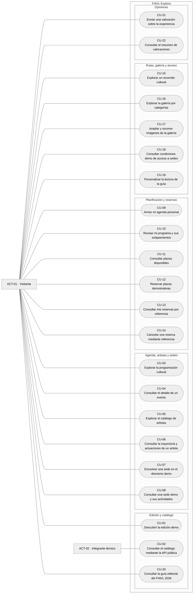

# Vista de escenarios (+1)

El visitante usa la aplicación web. El integrante técnico utiliza la API pública para verificar o consultar el catálogo. Los grupos del diagrama organizan objetivos por tema. Las líneas representan asociaciones entre rol y caso de uso. [Actores, criterios de agrupación y flujos](analysis/02-actores-y-casos-de-uso.md).

## ESC-01 · Casos de uso de FIAVL Explora

<!-- diagram: ESC-01 -->

## Catálogo

| Código | Caso de uso | Actor | Spec | Objetivo |
|---|---|---|---|---|
| [CU-01](03-vista-procesos/secuencias/CU-01-descubrir-edicion.md) | Descubrir la edición demo | ACT-01 | 1 | Reconocer la edición y llegar a una sección o a la selección demo. |
| [CU-02](03-vista-procesos/secuencias/CU-02-consultar-catalogo-api.md) | Consultar el catálogo mediante la API pública | ACT-02 | 1 | Obtener una colección demo o recuperar una ficha por identidad. |
| [CU-03](03-vista-procesos/secuencias/CU-03-explorar-programacion.md) | Explorar la programación cultural | ACT-01 | 2 | Localizar eventos demo por interés, fecha, categoría o precio. |
| [CU-04](03-vista-procesos/secuencias/CU-04-detalle-evento.md) | Consultar el detalle de un evento | ACT-01 | 2 | Conocer descripción, horario completo, sede, artistas y precio de un evento. |
| [CU-05](03-vista-procesos/secuencias/CU-05-explorar-artistas.md) | Explorar el catálogo de artistas | ACT-01 | 3 | Encontrar artistas por nombre, país o disciplina. |
| [CU-06](03-vista-procesos/secuencias/CU-06-detalle-artista.md) | Consultar la trayectoria y actuaciones de un artista | ACT-01 | 3 | Leer la biografía y saber en qué eventos participa un artista. |
| [CU-07](03-vista-procesos/secuencias/CU-07-buscar-sede.md) | Encontrar una sede en el directorio demo | ACT-01 | 4 | Localizar una sede por nombre o dirección. |
| [CU-08](03-vista-procesos/secuencias/CU-08-detalle-sede.md) | Consultar una sede demo y sus actividades | ACT-01 | 4 | Conocer dónde está una sede, sus notas demo de acceso y sus actividades. |
| [CU-09](03-vista-procesos/secuencias/CU-09-armar-agenda.md) | Armar mi agenda personal | ACT-01 | 5 | Guardar o quitar eventos de mi selección personal. |
| [CU-10](03-vista-procesos/secuencias/CU-10-revisar-agenda.md) | Revisar mi programa y sus solapamientos | ACT-01 | 5 | Recuperar el programa y detectar conflictos de horarios. |
| [CU-11](03-vista-procesos/secuencias/CU-11-consultar-plazas.md) | Consultar plazas disponibles | ACT-01 | 6 | Saber qué eventos admiten reserva y cuántas plazas les quedan. |
| [CU-12](03-vista-procesos/secuencias/CU-12-reservar-plazas.md) | Reservar plazas demostrativas | ACT-01 | 6 | Obtener una reserva activa y una referencia para recuperarla o cancelarla. |
| [CU-13](03-vista-procesos/secuencias/CU-13-consultar-reservas.md) | Consultar mis reservas por referencia | ACT-01 | 6 | Recuperar el estado de las referencias recordadas y gestionar esa lista local. |
| [CU-14](03-vista-procesos/secuencias/CU-14-cancelar-reserva.md) | Cancelar una reserva mediante referencia | ACT-01 | 6 | Liberar las plazas de una reserva cuya referencia posee. |
| [CU-15](03-vista-procesos/secuencias/CU-15-explorar-recorrido.md) | Explorar un recorrido cultural | ACT-01 | 7 | Recorrer una secuencia temática de sedes y conocer cada parada. |
| [CU-16](03-vista-procesos/secuencias/CU-16-explorar-galeria.md) | Explorar la galería por categorías | ACT-01 | 8 | Encontrar imágenes y reconocer su procedencia. |
| [CU-17](03-vista-procesos/secuencias/CU-17-ampliar-galeria.md) | Ampliar y recorrer imágenes de la galería | ACT-01 | 8 | Examinar una imagen ampliada y sus créditos, y recorrer resultados vecinos. |
| [CU-18](03-vista-procesos/secuencias/CU-18-consultar-acceso.md) | Consultar condiciones demo de acceso a sedes | ACT-01 | 9 | Encontrar notas de acceso y dirección de una sede demo. |
| [CU-19](03-vista-procesos/secuencias/CU-19-personalizar-lectura.md) | Personalizar la lectura de la guía | ACT-01 | 9 | Ajustar y conservar tamaño y contraste o recuperar los valores predeterminados. |
| [CU-20](03-vista-procesos/secuencias/CU-20-consultar-guia-editorial.md) | Consultar la guía editorial del FIAVL 2026 | ACT-01 | 10 | Identificar obras, artistas, horarios y sedes documentadas y acceder a la fuente. |
| [CU-21](03-vista-procesos/secuencias/CU-21-enviar-valoracion.md) | Enviar una valoración sobre la experiencia | ACT-01 | 10 | Compartir una puntuación y un comentario opcional y recibir confirmación. |
| [CU-22](03-vista-procesos/secuencias/CU-22-consultar-resumen.md) | Consultar el resumen de valoraciones | ACT-01 | 10 | Conocer el total, la distribución y el promedio agregado de respuestas. |

Cada código enlaza a su secuencia. La [matriz de trazabilidad](06-matriz-trazabilidad.md) enlaza requisitos, fuentes y pruebas.
