# FIAVL Explora

## Arquitectura de software con el modelo 4+1

**Asignatura** Arquitectura de Software 
**Proyecto** FIAVL Explora · Prototipo académico 
**Institución** [Completar institución] 
**Docente** [Completar nombre del docente] 
**Integrantes** [Completar nombres y datos académicos] 
**Fecha de entrega** [Completar fecha]

**Implementación de referencia** `ff11546da61896fc7f6d363f63ebb793aed2f3ea`

## Índice

1. [Introducción](#1-introducción)
2. [Estilo arquitectónico adoptado](#2-estilo-arquitectónico-adoptado)
3. [Modelo arquitectónico 4+1](#3-modelo-arquitectónico-41)
4. [Vista lógica](#4-vista-lógica)
5. [Vista de desarrollo](#5-vista-de-desarrollo)
6. [Vista de procesos](#6-vista-de-procesos)
7. [Vista física](#7-vista-física)
8. [Vista de escenarios](#8-vista-de-escenarios)
9. [Matriz de trazabilidad](#9-matriz-de-trazabilidad)
10. [Conclusiones](#10-conclusiones)
11. [Referencias](#11-referencias)

## 1. Introducción

FIAVL Explora presenta una edición demostrativa del Festival Internacional de Artes Vivas de Loja. El público puede explorar programación, artistas, sedes, recorridos y recursos gráficos, organizar su agenda local, reservar plazas demo, ajustar la lectura y enviar una opinión. La guía editorial publica fichas estáticas diferenciadas del catálogo demo.

El documento describe las diez especificaciones integradas en `main` a partir del SHA indicado en la portada. Las superficies verificadas y las pruebas versionadas se detallan en el [inventario técnico](../analysis/01-inventario-arquitectonico.md) y la [validación documental](../validation.md).

## 2. Estilo arquitectónico adoptado

El prototipo usa un modelo cliente-servidor con tres capas lógicas. La capa de **presentación** incluye React/TypeScript, el cliente HTTP y la adaptación Express. La capa de **negocio** valida los datos de entrada y aplica las reglas de consulta, disponibilidad, reserva y encuesta. La capa de **acceso a datos** encapsula SQL y convierte filas mediante repositorios. El navegador se comunica por REST/JSON y el proceso Node.js ejecuta SQLite embebido. Web y API comparten los esquemas TypeScript/Zod mediante npm workspaces. [ADR 005](../../adr.md).

## 3. Modelo arquitectónico 4+1

Las vistas relacionan el dominio, las dependencias del código, la ejecución y la topología mediante escenarios observables. Las vistas de clases y secuencia emplean sintaxis específica de Mermaid. Las restantes usan `flowchart`, con convenciones que preservan la intención conceptual de cada dibujo.

| Vista | Diagramas | Cantidad |
|---|---|---:|
| Lógica | Clases del dominio | 1 |
| Desarrollo | Componentes y paquetes | 2 |
| Procesos | 22 secuencias funcionales, 1 técnica y 5 actividades | 28 |
| Física | Despliegue local | 1 |
| Escenarios (+1) | Casos de uso | 1 |
| | **Total** | **33** |

## 4. Vista lógica

Evento, Artista y Sede son DTO inferidos de Zod y conceptos del catálogo. Cada evento tiene una sede. Los créditos asocian eventos y artistas y guardan el orden editorial. La reserva pertenece a un evento, persiste el hash de la referencia y cambia de activa a cancelada. La valoración es independiente. El agregado y la disponibilidad se calculan a partir de filas existentes. Agenda y preferencias conservan datos en el navegador. Las fichas editoriales se empaquetan con el frontend. [Decisiones de modelado](../01-vista-logica.md).

### LOG-01 · Dominio y estructuras relevantes

Tipos y tablas de catálogo, créditos, reservas y valoraciones. Distingue DTO y modelos del navegador.


[Mermaid original](../diagrams/LOG-01.mmd) · [Fuente canónica](../01-vista-logica.md).

## 5. Vista de desarrollo

La primera figura describe responsabilidades y llamadas entre componentes. La segunda representa la organización por rutas, workspaces y dependencias estáticas. La composición raíz conecta routers, servicios y repositorios mediante interfaces y objetos de operaciones. Los esquemas Zod se incluyen como biblioteca. [Vista de desarrollo](../02-vista-desarrollo.md).

### DES-01 · Componentes y responsabilidades

Traza llamadas de componentes y adaptadores, servicios, repositorios y datos.


[Mermaid original](../diagrams/DES-01.mmd) · [Fuente canónica](../02-vista-desarrollo.md).

### DES-02 · Paquetes y dependencias estáticas

Explica los módulos y dependencias de código, workspaces y herramientas.


[Mermaid original](../diagrams/DES-02.mmd) · [Fuente canónica](../02-vista-desarrollo.md).

## 6. Vista de procesos

La web inicia lecturas HTTP asíncronas y controla estados de carga, error y reintento. Sus fichas precargadas, el diálogo y los ajustes responden con mecanismos locales. El backend ejecuta operaciones síncronas de SQLite. En una creación de reserva, el bloqueo de escritura precede la lectura del aforo y se mantiene hasta confirmar o revertir. Cada intento recalcula las plazas activas que quedan. Una cancelación repetida conserva el resultado anterior. [Vista de procesos](../03-vista-procesos/README.md).

### CU-01 · Descubrir la edición demo

Reconocer la edición y llegar a una sección o a la selección demo. Participan App, Header, Home, StageCarousel, Selection, cliente HTTP, catálogo.

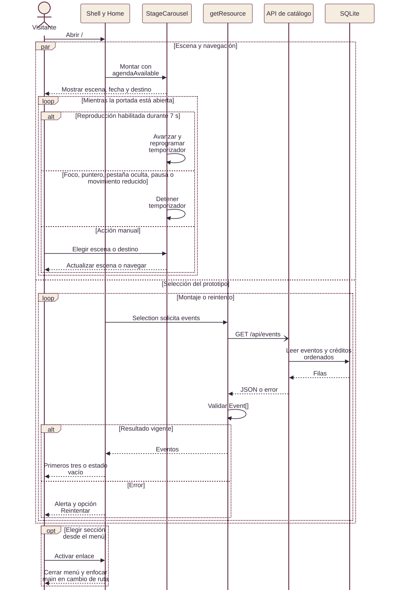

[Mermaid original](../diagrams/CU-01.mmd) · [Fuente canónica](../03-vista-procesos/secuencias/CU-01-descubrir-edicion.md).

### CU-02 · Consultar el catálogo mediante la API pública

Obtener una colección demo o recuperar una ficha por identidad. Participan Cliente HTTP externo, Express, servicio y repositorio de catálogo, Zod, SQLite.

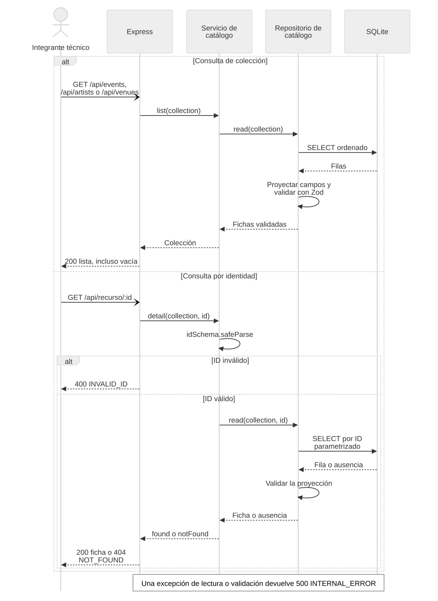

[Mermaid original](../diagrams/CU-02.mmd) · [Fuente canónica](../03-vista-procesos/secuencias/CU-02-consultar-catalogo-api.md).

### CU-03 · Explorar la programación cultural

Localizar eventos demo por interés, fecha, categoría o precio. Participan Agenda, getResource, filterEvents, catálogo.

[Mermaid original](../diagrams/CU-03.mmd) · [Fuente canónica](../03-vista-procesos/secuencias/CU-03-explorar-programacion.md).

### CU-04 · Consultar el detalle de un evento

Conocer descripción, horario completo, sede, artistas y precio de un evento. Participan Agenda, StageButton, mapas del catálogo.

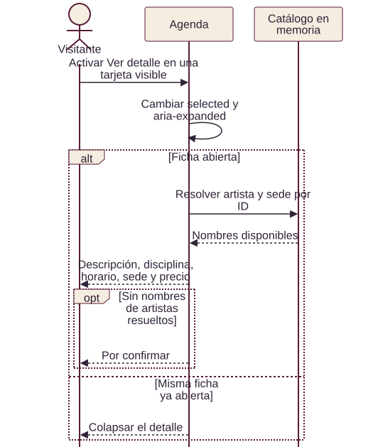

[Mermaid original](../diagrams/CU-04.mmd) · [Fuente canónica](../03-vista-procesos/secuencias/CU-04-detalle-evento.md).

### CU-05 · Explorar el catálogo de artistas

Encontrar artistas por nombre, país o disciplina. Participan Artistas, getResource, filterArtists, catálogo.

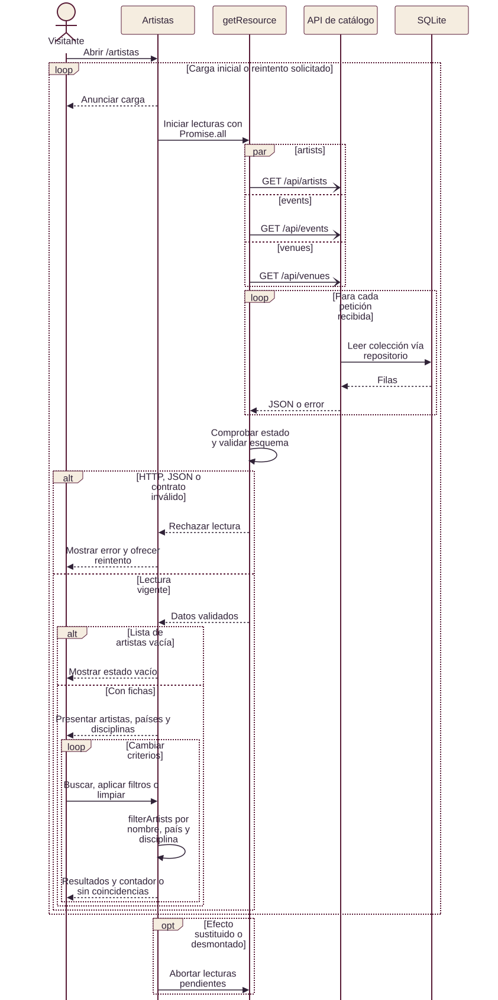

[Mermaid original](../diagrams/CU-05.mmd) · [Fuente canónica](../03-vista-procesos/secuencias/CU-05-explorar-artistas.md).

### CU-06 · Consultar la trayectoria y actuaciones de un artista

Leer la biografía y saber en qué eventos participa un artista. Participan ArtistCard, performancesOf, datos en React.

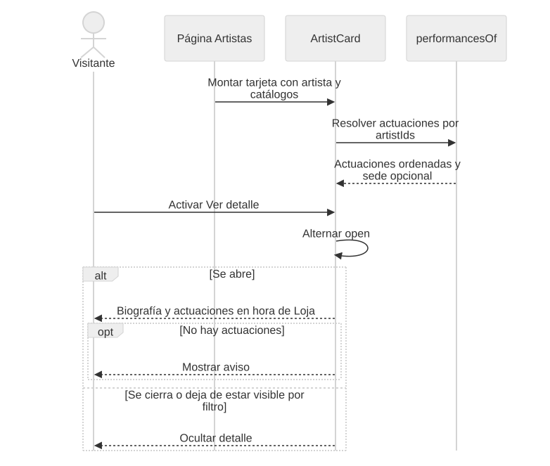

[Mermaid original](../diagrams/CU-06.mmd) · [Fuente canónica](../03-vista-procesos/secuencias/CU-06-detalle-artista.md).

### CU-07 · Encontrar una sede en el directorio demo

Localizar una sede por nombre o dirección. Participan Espacios, getResource, searchable, catálogo.

[Mermaid original](../diagrams/CU-07.mmd) · [Fuente canónica](../03-vista-procesos/secuencias/CU-07-buscar-sede.md).

### CU-08 · Consultar una sede demo y sus actividades

Conocer dónde está una sede, sus notas demo de acceso y sus actividades. Participan Espacios, VenueDetails, details/summary.

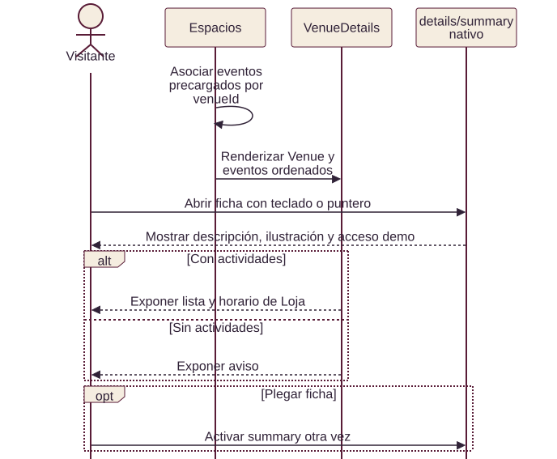

[Mermaid original](../diagrams/CU-08.mmd) · [Fuente canónica](../03-vista-procesos/secuencias/CU-08-detalle-sede.md).

### CU-09 · Armar mi agenda personal

Guardar o quitar eventos de mi selección personal. Participan Mi agenda, lógica local, writeLocal, almacenamiento del navegador.

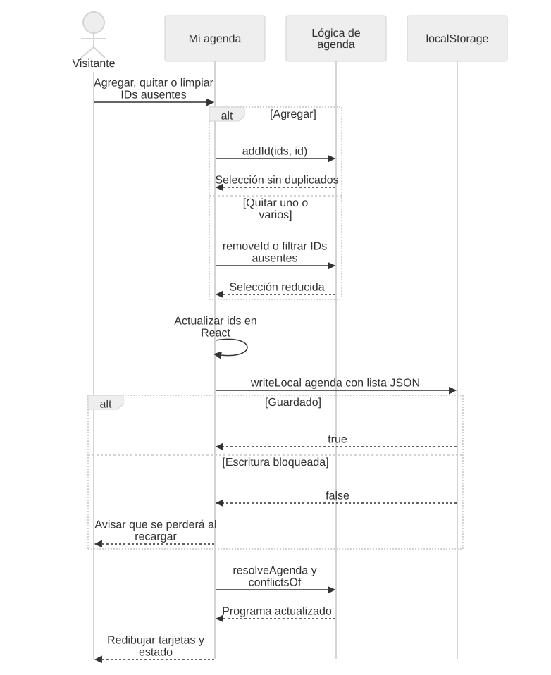

[Mermaid original](../diagrams/CU-09.mmd) · [Fuente canónica](../03-vista-procesos/secuencias/CU-09-armar-agenda.md).

### CU-10 · Revisar mi programa y sus solapamientos

Recuperar el programa y detectar conflictos de horarios. Participan Mi agenda, readLocal, lógica local, getResource, catálogo.

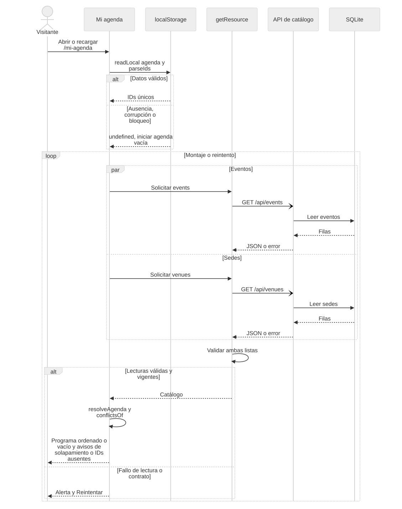

[Mermaid original](../diagrams/CU-10.mmd) · [Fuente canónica](../03-vista-procesos/secuencias/CU-10-revisar-agenda.md).

### CU-11 · Consultar plazas disponibles

Saber qué eventos admiten reserva y cuántas plazas les quedan. Participan Reservas, getResource, routers, servicios y repositorios de catálogo y reservas.

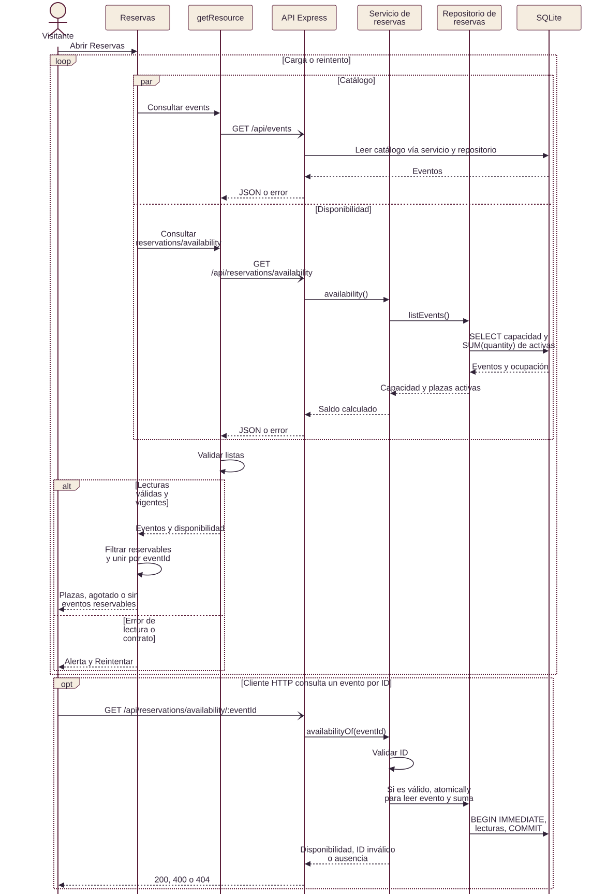

[Mermaid original](../diagrams/CU-11.mmd) · [Fuente canónica](../03-vista-procesos/secuencias/CU-11-consultar-plazas.md).

### CU-12 · Reservar plazas demostrativas

Obtener una reserva activa y una referencia para recuperarla o cancelarla. Participan Reservas, checkQuantity, postJson, router, servicio, repositorio, SQLite, writeLocal.

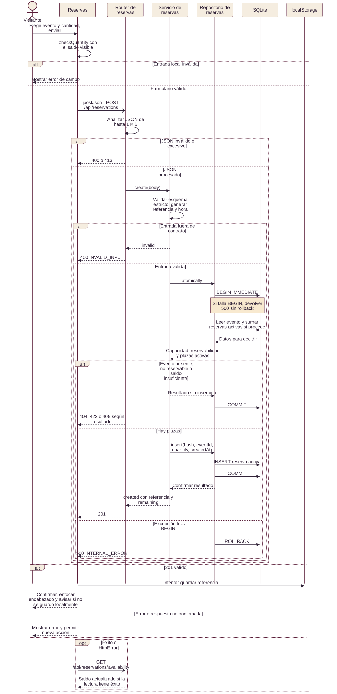

[Mermaid original](../diagrams/CU-12.mmd) · [Fuente canónica](../03-vista-procesos/secuencias/CU-12-reservar-plazas.md).

### CU-13 · Consultar mis reservas por referencia

Recuperar el estado de las referencias recordadas y gestionar esa lista local. Participan Reservas, readLocal/writeLocal, getResource, router, servicio y repositorio.

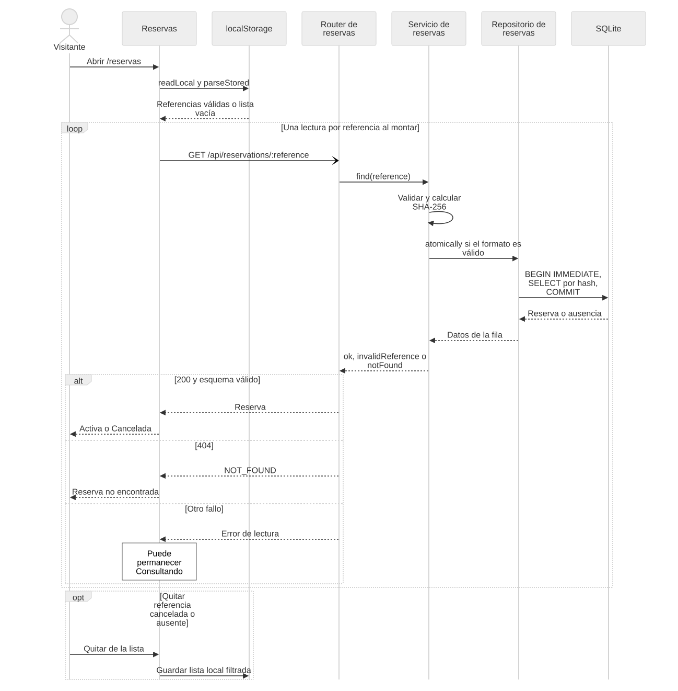

[Mermaid original](../diagrams/CU-13.mmd) · [Fuente canónica](../03-vista-procesos/secuencias/CU-13-consultar-reservas.md).

### CU-14 · Cancelar una reserva mediante referencia

Liberar las plazas de una reserva cuya referencia posee. Participan Reservas, postJson, router, servicio, repositorio, SQLite.

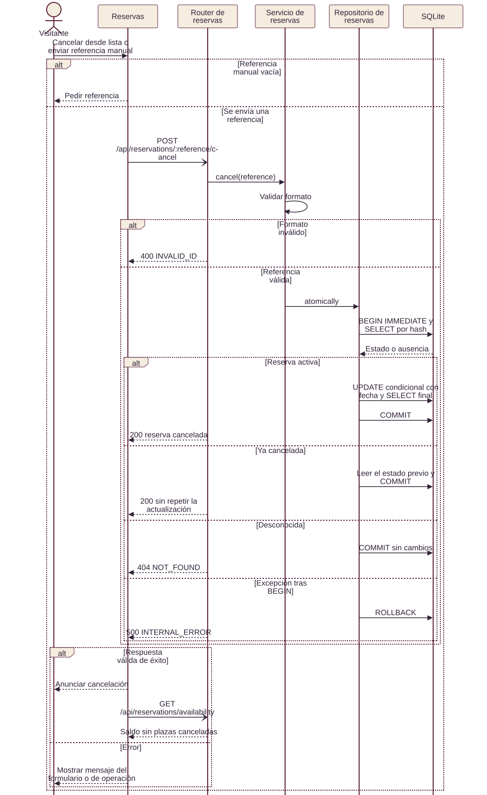

[Mermaid original](../diagrams/CU-14.mmd) · [Fuente canónica](../03-vista-procesos/secuencias/CU-14-cancelar-reserva.md).

### CU-15 · Explorar un recorrido cultural

Recorrer una secuencia temática de sedes y conocer cada parada. Participan Rutas, Recorrido, itinerarios, getResource, catálogo.

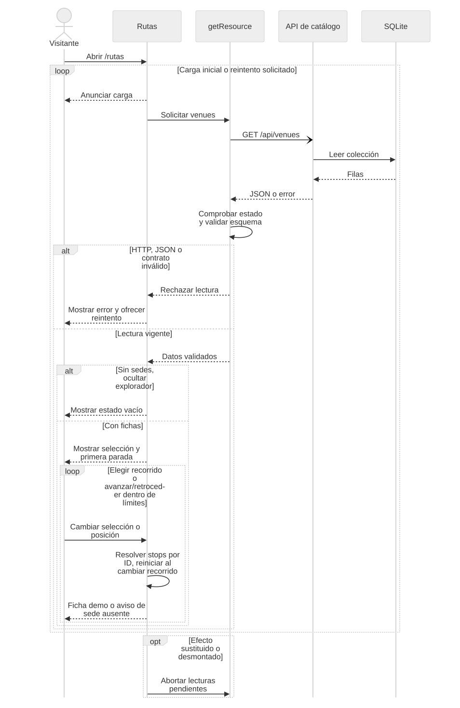

[Mermaid original](../diagrams/CU-15.mmd) · [Fuente canónica](../03-vista-procesos/secuencias/CU-15-explorar-recorrido.md).

### CU-16 · Explorar la galería por categorías

Encontrar imágenes y reconocer su procedencia. Participan Galería, Picture, buildItems, categoryCounts, getResource, catálogo.

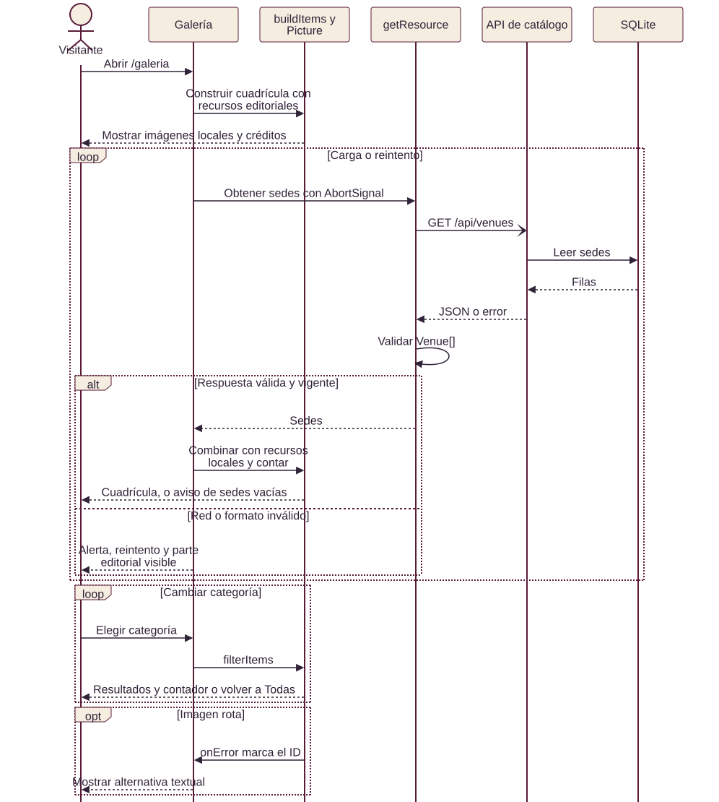

[Mermaid original](../diagrams/CU-16.mmd) · [Fuente canónica](../03-vista-procesos/secuencias/CU-16-explorar-galeria.md).

### CU-17 · Ampliar y recorrer imágenes de la galería

Examinar una imagen ampliada y sus créditos, y recorrer resultados vecinos. Participan Galería, Lightbox, Picture, neighbour, API DOM del navegador.

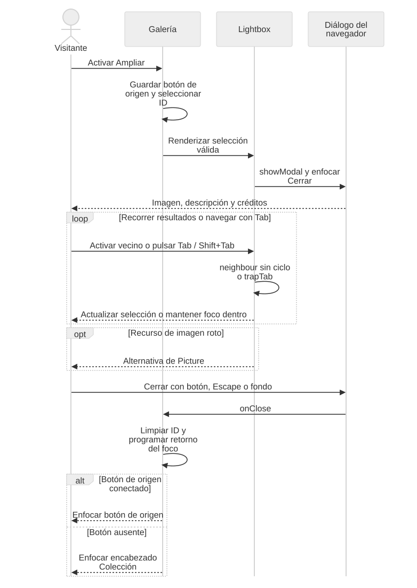

[Mermaid original](../diagrams/CU-17.mmd) · [Fuente canónica](../03-vista-procesos/secuencias/CU-17-ampliar-galeria.md).

### CU-18 · Consultar condiciones demo de acceso a sedes

Encontrar notas de acceso y dirección de una sede demo. Participan Guía de accesibilidad, VenueCard, filterVenues, getResource, catálogo.

[Mermaid original](../diagrams/CU-18.mmd) · [Fuente canónica](../03-vista-procesos/secuencias/CU-18-consultar-acceso.md).

### CU-19 · Personalizar la lectura de la guía

Ajustar y conservar tamaño y contraste o recuperar los valores predeterminados. Participan Guía, restore, preferencesSchema, readLocal/writeLocal, CSS.

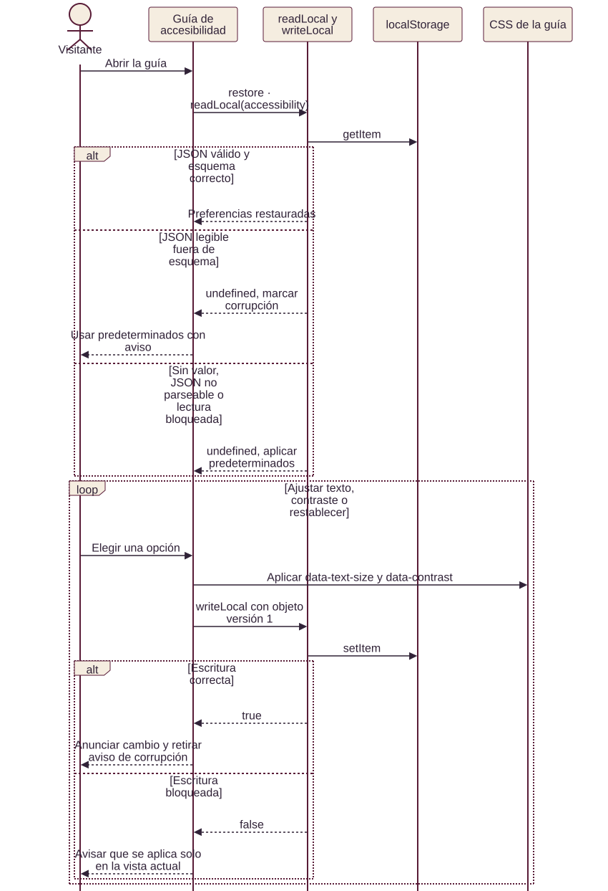

[Mermaid original](../diagrams/CU-19.mmd) · [Fuente canónica](../03-vista-procesos/secuencias/CU-19-personalizar-lectura.md).

### CU-20 · Consultar la guía editorial del FIAVL 2026

Identificar obras, artistas, horarios y sedes documentadas y acceder a la fuente. Participan FestivalProgram, FestivalVenues, MuseumPhoto, datos `festival2026.ts`.

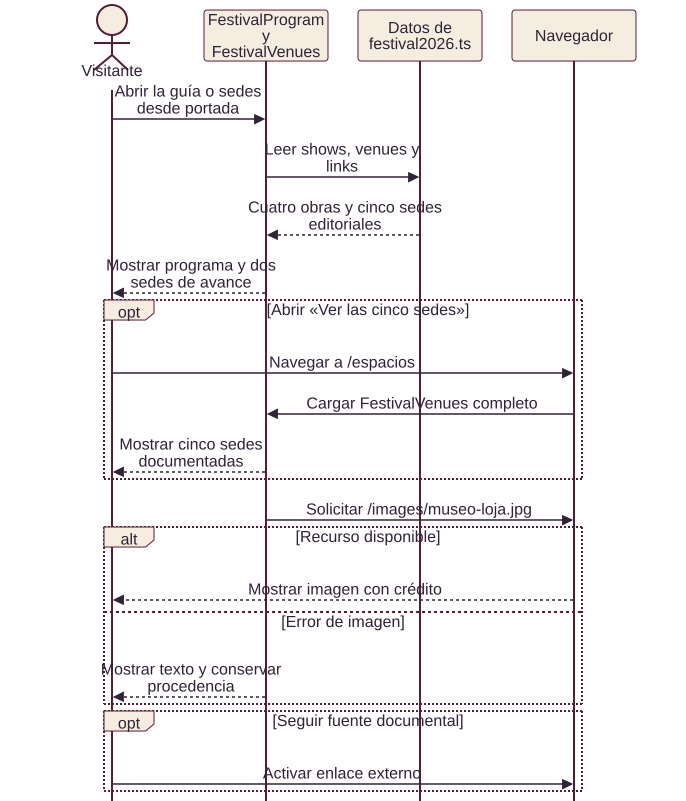

[Mermaid original](../diagrams/CU-20.mmd) · [Fuente canónica](../03-vista-procesos/secuencias/CU-20-consultar-guia-editorial.md).

### CU-21 · Enviar una valoración sobre la experiencia

Compartir una puntuación y un comentario opcional y recibir confirmación. Participan Opiniones, esquema compartido, fetch, router, servicio, repositorio, SQLite.

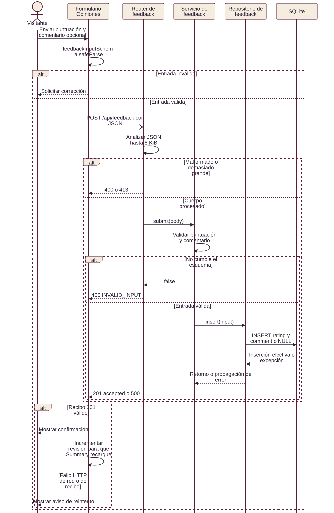

[Mermaid original](../diagrams/CU-21.mmd) · [Fuente canónica](../03-vista-procesos/secuencias/CU-21-enviar-valoracion.md).

### CU-22 · Consultar el resumen de valoraciones

Conocer el total, la distribución y el promedio agregado de respuestas. Participan Summary, getResource, router, servicio, repositorio, SQLite.

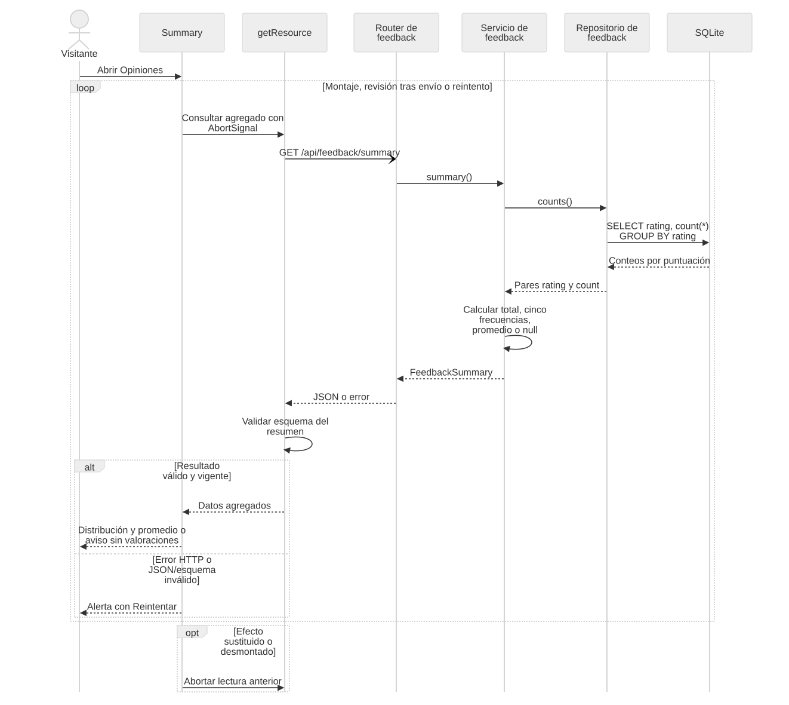

[Mermaid original](../diagrams/CU-22.mmd) · [Fuente canónica](../03-vista-procesos/secuencias/CU-22-consultar-resumen.md).

### TEC-01 · Contención por el mismo aforo

Dos clientes, una disponibilidad inicial, exclusión de escrituras y resultados según orden de confirmación.

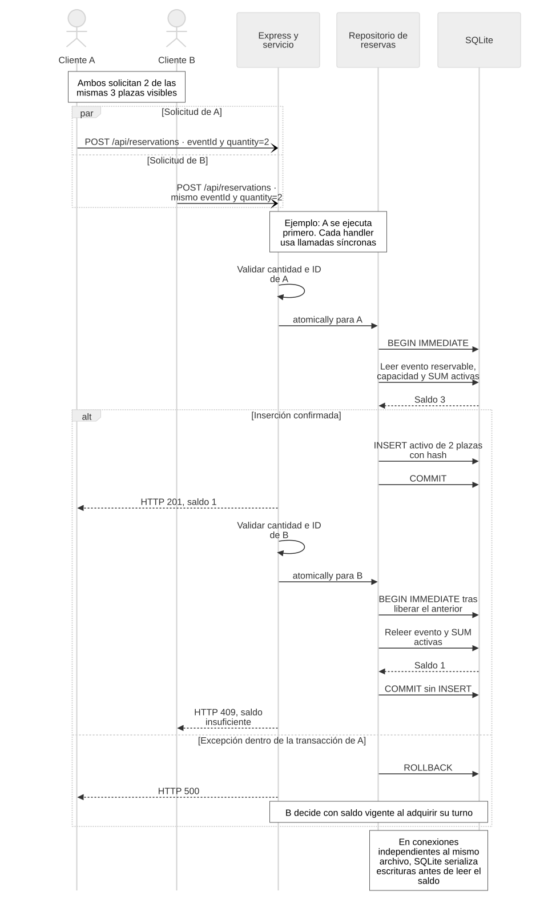

[Mermaid original](../diagrams/TEC-01.mmd) · [Fuente canónica](../03-vista-procesos/secuencias/TEC-01-reservas-concurrentes.md).

### ACTV-01 · Planificar la agenda y detectar conflictos

Expone el ciclo de edición, guardado tolerante a fallos y revisión de conflictos. La lectura fallida se puede reintentar con la selección local intacta.


[Mermaid original](../diagrams/ACTV-01.mmd) · [Fuente canónica](../03-vista-procesos/actividades/ACTV-01-planificar-agenda.md).

### ACTV-02 · Validar y confirmar una reserva

Hace visibles las ramas de validación, evento, aforo y excepción. La decisión de aforo ocurre dentro de la transacción.


[Mermaid original](../diagrams/ACTV-02.mmd) · [Fuente canónica](../03-vista-procesos/actividades/ACTV-02-crear-reserva.md).

### ACTV-03 · Cancelar una reserva de forma idempotente

Distingue el cambio de activa a cancelada de una solicitud repetida. El saldo vuelve a calcularse a partir de las activas.


[Mermaid original](../diagrams/ACTV-03.mmd) · [Fuente canónica](../03-vista-procesos/actividades/ACTV-03-cancelar-reserva.md).

### ACTV-04 · Restaurar y ajustar preferencias de lectura

Expone la recuperación de datos fuera de esquema, el restablecimiento y la posibilidad de aplicar un ajuste que no se pudo guardar.


[Mermaid original](../diagrams/ACTV-04.mmd) · [Fuente canónica](../03-vista-procesos/actividades/ACTV-04-ajustar-accesibilidad.md).

### ACTV-05 · Validar y confirmar una valoración

Distingue validación cliente/servidor, persistencia y confirmación del recibo. El reintento del formulario puede ocurrir tras una respuesta no confirmada.


[Mermaid original](../diagrams/ACTV-05.mmd) · [Fuente canónica](../03-vista-procesos/actividades/ACTV-05-enviar-valoracion.md).

## 7. Vista física

La ejecución local usa Vite en `127.0.0.1:5173` y Express en `127.0.0.1:3001`. Vite reenvía `/api`. SQLite se ejecuta en el backend y conserva el archivo en el anfitrión. El bootstrap Windows prepara el runtime, las dependencias y la semilla. El build emite el conjunto de archivos estáticos y el JavaScript del backend. [Despliegue y modos de ejecución](../04-vista-fisica.md).

### FIS-01 · Despliegue local documentado

Computadora anfitriona, navegador y origen, bootstrap, procesos, puertos y archivo SQLite.


[Mermaid original](../diagrams/FIS-01.mmd) · [Fuente canónica](../04-vista-fisica.md).

## 8. Vista de escenarios

El visitante cumple los objetivos de la interfaz web. El integrante técnico consulta el catálogo público por HTTP como parte del objetivo de verificar sus datos. El alcance de cada objetivo y sus variaciones se detallan en el [catálogo de actores y casos](../analysis/02-actores-y-casos-de-uso.md).

### ESC-01 · Casos de uso de FIAVL Explora

Dos actores externos, límite del sistema y objetivos agrupados. Las asociaciones se trazan a casos concretos.


[Mermaid original](../diagrams/ESC-01.mmd) · [Fuente canónica](../05-vista-escenarios.md).

## 9. Matriz de trazabilidad

| Spec | Caso de uso | Requisito o historia | Secuencia |
|---|---|---|---|
| 1 | CU-01 · Descubrir la edición demo | FR-003–004, US2, SC-002. También Spec 10 US1–2, US6–7 y V1–V5, C4–C5. | [CU-01](../03-vista-procesos/secuencias/CU-01-descubrir-edicion.md) |
| 1 | CU-02 · Consultar el catálogo mediante la API pública | FR-001 (lecturas), FR-002, US1, SC-001. | [CU-02](../03-vista-procesos/secuencias/CU-02-consultar-catalogo-api.md) |
| 2 | CU-03 · Explorar la programación cultural | US1, US2, US4, FR-001–004, SC-001. | [CU-03](../03-vista-procesos/secuencias/CU-03-explorar-programacion.md) |
| 2 | CU-04 · Consultar el detalle de un evento | US3 y requisitos transversales FR-002–004. | [CU-04](../03-vista-procesos/secuencias/CU-04-detalle-evento.md) |
| 3 | CU-05 · Explorar el catálogo de artistas | US1–2, US4, FR-001–003, FR-005–009, SC-001, SC-003–005. | [CU-05](../03-vista-procesos/secuencias/CU-05-explorar-artistas.md) |
| 3 | CU-06 · Consultar la trayectoria y actuaciones de un artista | US3, FR-004, SC-002 y SC-004. | [CU-06](../03-vista-procesos/secuencias/CU-06-detalle-artista.md) |
| 4 | CU-07 · Encontrar una sede en el directorio demo | US1, US3, R1, R4–R5. | [CU-07](../03-vista-procesos/secuencias/CU-07-buscar-sede.md) |
| 4 | CU-08 · Consultar una sede demo y sus actividades | US2, R2–R5. | [CU-08](../03-vista-procesos/secuencias/CU-08-detalle-sede.md) |
| 5 | CU-09 · Armar mi agenda personal | Historias 1 y 3, edición, duplicado, limpieza y guardado. | [CU-09](../03-vista-procesos/secuencias/CU-09-armar-agenda.md) |
| 5 | CU-10 · Revisar mi programa y sus solapamientos | Historias 1–3 y estados de carga, error y vacío. | [CU-10](../03-vista-procesos/secuencias/CU-10-revisar-agenda.md) |
| 6 | CU-11 · Consultar plazas disponibles | US2, US4, R1, R6. | [CU-11](../03-vista-procesos/secuencias/CU-11-consultar-plazas.md) |
| 6 | CU-12 · Reservar plazas demostrativas | US1, US4–5, R1–R7, E1–E2 y E4–E5. | [CU-12](../03-vista-procesos/secuencias/CU-12-reservar-plazas.md) |
| 6 | CU-13 · Consultar mis reservas por referencia | US3–5, R5–R7; contrato GET por referencia. | [CU-13](../03-vista-procesos/secuencias/CU-13-consultar-reservas.md) |
| 6 | CU-14 · Cancelar una reserva mediante referencia | US3–5, R2–R6, E3. | [CU-14](../03-vista-procesos/secuencias/CU-14-cancelar-reserva.md) |
| 7 | CU-15 · Explorar un recorrido cultural | US1–3, R1–R5, éxito medible. | [CU-15](../03-vista-procesos/secuencias/CU-15-explorar-recorrido.md) |
| 8 | CU-16 · Explorar la galería por categorías | US1–2, US4–5, R1–3, R5–R7. | [CU-16](../03-vista-procesos/secuencias/CU-16-explorar-galeria.md) |
| 8 | CU-17 · Ampliar y recorrer imágenes de la galería | US2–4, R4–R6. | [CU-17](../03-vista-procesos/secuencias/CU-17-ampliar-galeria.md) |
| 9 | CU-18 · Consultar condiciones demo de acceso a sedes | US1–2, US5, R1–2, R5–6. | [CU-18](../03-vista-procesos/secuencias/CU-18-consultar-acceso.md) |
| 9 | CU-19 · Personalizar la lectura de la guía | US3–5, R3–6. | [CU-19](../03-vista-procesos/secuencias/CU-19-personalizar-lectura.md) |
| 10 | CU-20 · Consultar la guía editorial del FIAVL 2026 | US5, C1–C3 y C5. | [CU-20](../03-vista-procesos/secuencias/CU-20-consultar-guia-editorial.md) |
| 10 | CU-21 · Enviar una valoración sobre la experiencia | US3, E1, E3 y C5. | [CU-21](../03-vista-procesos/secuencias/CU-21-enviar-valoracion.md) |
| 10 | CU-22 · Consultar el resumen de valoraciones | US4, E2–E3. | [CU-22](../03-vista-procesos/secuencias/CU-22-consultar-resumen.md) |

La [matriz completa](../06-matriz-trazabilidad.md) enlaza componentes, archivos, pruebas, actividades y requisitos transversales. El [inventario de figuras](../analysis/04-inventario-diagramas.md) incluye la ruta de todos los originales y de los recursos exportados.

## 10. Conclusiones

El diseño por capas mantiene las reglas de aforo y encuesta en el backend. El navegador usa datos del catálogo para sus filtros y conserva de manera local la selección personal y las preferencias de lectura. Los escenarios de reserva muestran la correspondencia entre una acción de usuario, el contrato REST y la transacción SQLite. Los diagramas estructurales y de ejecución reflejan la misma implementación en las diez specs.

## 11. Referencias

- Philippe Kruchten. «The 4+1 View Model of Architecture». *IEEE Software*, 12(6), 42–50, 1995. [Texto del autor](https://arxiv.org/abs/2006.04975).
- Mermaid. [Referencia de sintaxis](https://mermaid.js.org/intro/syntax-reference.html).
- GitHub Docs. [Creación y visualización de diagramas](https://docs.github.com/en/get-started/writing-on-github/working-with-advanced-formatting/creating-diagrams).
- FIAVL Explora. [Repositorio en el SHA de referencia](https://github.com/magomez36/FIAVL_Arquitectura-de-Software/tree/ff11546da61896fc7f6d363f63ebb793aed2f3ea), [contratos](../../contracts.md), [decisiones arquitectónicas](../../adr.md) y [procedencia de recursos](../../assets.md).
