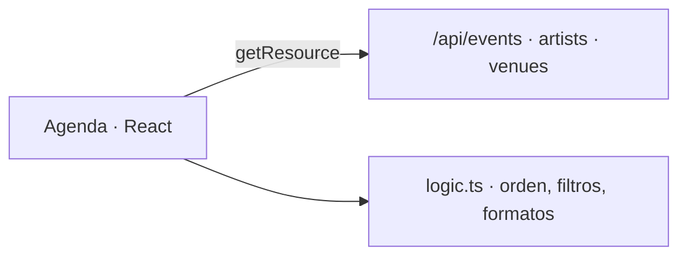

# Implementation Plan: Programación cultural

**Summary**: página de solo lectura en la capa de presentación; sin cambios en API ni datos.

## Technical Context
React/TypeScript/Vite, Zod de `@fiavl/contracts`, `node --test`, Playwright. Node 24.22.3, npm 11.17.0.

## Constitution Check
I Tres capas: solo presentación, consume HTTP. II Demo reproducible: sin cuentas ni secretos. III Acceso y procedencia: teclado, foco, aviso no oficial, imágenes `/art/*.svg` ya documentadas en docs/assets.md. IV Propiedad: solo archivos del spec. V Evidencia: ver validation.md.

## Source Code
```text
apps/web/src/features/agenda/index.tsx   # página y entrada Feature
apps/web/src/features/agenda/logic.ts    # orden, filtros, formato de hora/precio (puro)
apps/web/src/features/agenda/agenda.css  # estilos acotados con tokens --stage-*
tests/spec-02.test.ts                    # pruebas Node (lógica y coherencia visual)
tests/e2e/spec-02.spec.ts                # Playwright (escrito; ver validation.md)
```

## Nota arquitectónica

La hora usa `Intl` con `America/Guayaquil`; el día del filtro se lee de la cadena `-05:00`, sin depender de la zona del equipo.
