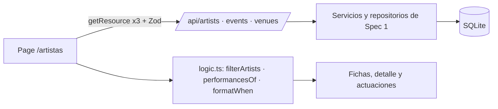

# Nota arquitectónica · Spec 3

Spec 3 es solo capa de presentación. No añade endpoints, SQL ni migraciones: reutiliza los GET de catálogo de Spec 1 (router → servicio → repositorio SQLite) mediante el cliente compartido `getResource`, validando cada respuesta con Zod en el borde del navegador. La lógica de filtrado y de relación artista–evento es pura (`logic.ts`) y no conoce HTTP ni React; `index.tsx` orquesta carga y estados. Ninguna importación cruza hacia otro spec.

