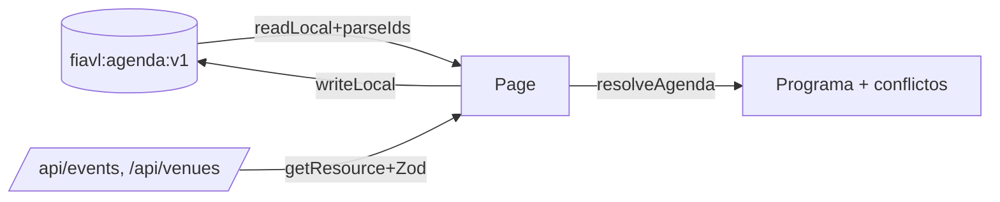

# Plan: Mi agenda

- `apps/web/src/features/mi-agenda/logic.ts`: funciones puras (parseo, añadir/quitar, solapamiento estricto, resolución contra el catálogo).
- `index.tsx`: página con `getResource('events'|'venues')`, `readLocal/writeLocal('agenda')`, componentes `Stage*`, `available: true`.
- `mi-agenda.css`: estilos acotados con tokens `--stage-*`, foco visible y `prefers-reduced-motion`.
- Sin endpoints, migraciones ni cambios en shell, contratos o `/agenda`. Navegación a `/agenda` con `Link` en el estado vacío.

